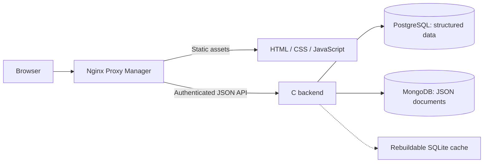

# OpenBoard

[](https://github.com/GiorgioOppo/OpenBoard/actions/workflows/ci.yml)
[](LICENSE)
[](docs/ROADMAP.md)

A self-hosted kanban and team collaboration application with a **C backend** and a **plain HTML, CSS and JavaScript frontend**. Plan work on boards, organize sprints, review cards and manage internal requests. OpenBoard is inspired by Trello and is an independent project, unaffiliated with Trello or Atlassian.

**Status: 0.6.1 early preview, with unreleased changes on the development branch.** Suitable for evaluation and pilot installations. External storage serializes requests; development changes publish modified rows incrementally, while initial import and stale-cache reconstruction retain complete snapshots. Capacity and high availability have not been established for enterprise workloads. See [known limitations](docs/ROADMAP.md#current-limitations), the [security review](docs/SECURITY_REMEDIATION_2026-10-16.md) and the [next 100 improvements ledger](docs/IMPROVEMENTS_NEXT_100.md). The published `v0.6.1` tag retains its original implementation.


## Quick start

Requirements: Docker with Compose v2 and Python 3. The first build compiles the C backend and patched database tools; allow time and network access for upstream dependencies. Ports 80, 443 and 81 must be available. See [deployment](docs/DEPLOYMENT.md) for alternative ports and configuration.

```sh
git clone https://github.com/GiorgioOppo/OpenBoard.git
cd OpenBoard
python3 scripts/init-env.py
docker compose up -d --build --wait
python3 scripts/bootstrap-local.py
python3 scripts/check-deployment.py
```

Open **http://openboard.localhost**. Sign in as `admin` with the generated `OPENBOARD_ADMIN_PASSWORD` from the private `.env.local-admin` file. The proxy console is **http://127.0.0.1:81**, using the separate NPM credentials in that file. Keep both `.env` and `.env.local-admin` private; they are excluded from Git and Docker builds.

HTTP, HTTPS and proxy administration bind to loopback by default. Public service access requires a real HTTPS origin, a certificate and the [deployment checks](docs/DEPLOYMENT.md). The local `.localhost` origin is for evaluation. Stop the stack with `docker compose stop`; keep the named volumes to preserve data.

## Features

- Boards, ordered lists and draggable cards; search, filters, calendar and table views.
- Checklists, labels, assignees, priorities, dates, dependencies and work-in-progress limits.
- Individual accounts, administrator/member/observer roles and board permissions.
- Comments, discussions, reactions, attachments, notifications and personal bookmarks.
- Custom fields, milestones, time tracking, workload reports and CSV/iCalendar exports.
- Card review requests, approvals, personal inboxes and cross-board portfolio reports.
- Sprints, backlog planning, capacity and explicitly captured daily snapshots.
- Internal forms, typed submissions, triage and atomic conversion into cards.
- Archive, trash, restoration, JSON board import/export and complete application backups.

The interface supports **English, Italian, French, Spanish, German, Simplified Chinese and Japanese**. It detects supported browser languages and provides a persistent selector. User-authored content keeps its original language. See [translation maintenance](docs/INTERNATIONALIZATION.md).

## Architecture



The backend serves APIs only. The frontend has no database credentials and requests authorized data from the same-origin API. PostgreSQL and MongoDB form one application dataset; SQLite is a temporary cache in Compose and a standalone storage option for local development. The frontend has no runtime framework or npm dependencies. The separate NPM proxy uses Node.js internally.

Read the [architecture](docs/ARCHITECTURE.md) for consistency, trust boundaries and current scalability limits. OpenBoard's code uses the MIT license; third-party servers, libraries and image packages have their [own licenses](THIRD_PARTY_NOTICES.md), including MongoDB Community Server's SSPL.

## Local development

Use a C11/POSIX compiler, `make`, SQLite with JSON support, OpenSSL libcrypto, `pkg-config` and Python 3. On macOS, install the Xcode command line tools and `brew install openssl@3 pkg-config`. On Debian/Ubuntu, install `build-essential libsqlite3-dev libssl-dev pkg-config python3`.

```sh
make EXTERNAL_STORAGE=0
./build/openboard --no-demo --public-url http://127.0.0.1:8090
# In a second terminal:
python3 scripts/dev-frontend.py
```

Open **http://127.0.0.1:8090** and create the first administrator. The API listens on loopback port 8080; SQLite data is stored in `data/openboard.db`. Stop both processes with `Ctrl+C`. See [CONTRIBUTING](CONTRIBUTING.md) for optional SQL/MongoDB builds and development conventions.

## Testing

```sh
make test
make test-sanitize
make test-frontend   # Requires Node.js
make test-security   # Requires Node.js
```

Tests use temporary databases and local servers. Docker image and external-storage checks are opt-in; see [the testing guide](docs/TESTING.md). CI verifies Linux/macOS, sanitizers and the five-service stack. A passing run applies to its commit, not uncommitted changes or a later image rebuild.

## Documentation and community

- [Documentation index](docs/README.md): setup, operations and API references.
- [User guide](docs/USER_GUIDE.md) and [troubleshooting](docs/TROUBLESHOOTING.md).
- [Deployment, upgrades and backups](docs/DEPLOYMENT.md).
- [Roadmap and limitations](docs/ROADMAP.md).
- [Security policy and private reporting](SECURITY.md).
- [Contributing](CONTRIBUTING.md), [support](SUPPORT.md) and [code of conduct](CODE_OF_CONDUCT.md).
- [Changelog](CHANGELOG.md), [release process](docs/RELEASING.md) and [publication checklist](docs/PUBLICATION.md).

OpenBoard is released under the [MIT license](LICENSE). Contributions are welcome; project direction and review responsibilities are described in [MAINTAINERS.md](MAINTAINERS.md).
