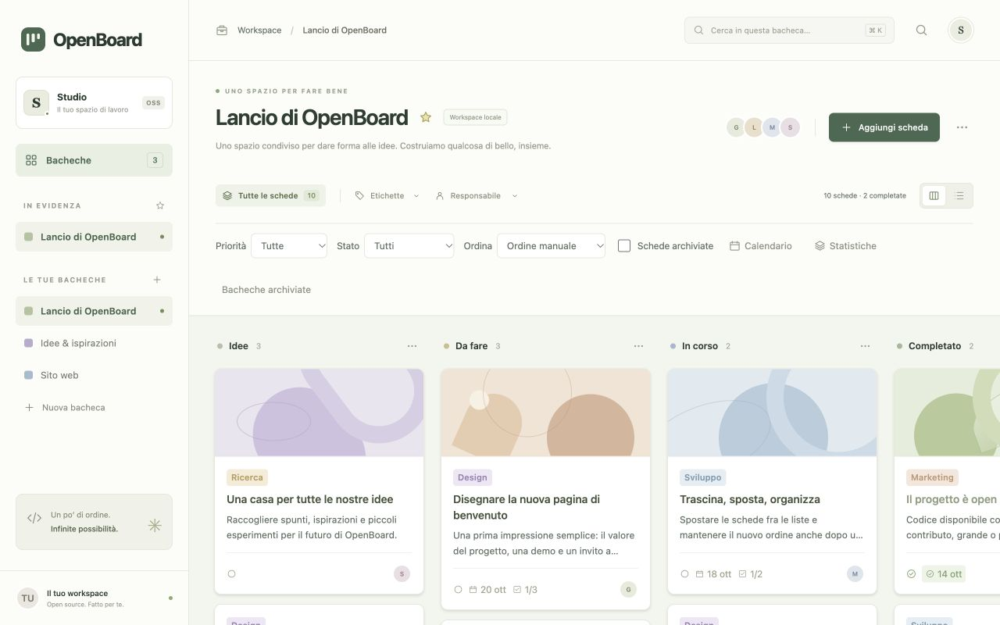

# OpenBoard

Un'app kanban open source ispirata a Trello, con **server in C e database SQLite**. L'interfaccia web è scritta in HTML, CSS e JavaScript senza framework, dipendenze npm, CDN o servizi esterni.



## Avvio rapido

Servono un compilatore C11, `make`, SQLite con supporto JSON, OpenSSL libcrypto e `pkg-config`.

Su macOS servono gli strumenti della riga di comando di Xcode e OpenSSL con `pkg-config`, installabili tramite Homebrew:

```sh
xcode-select --install
brew install openssl@3 pkg-config
```

Su Debian/Ubuntu:

```sh
sudo apt-get install build-essential libsqlite3-dev libssl-dev pkg-config python3
```

Dalla cartella del progetto:

```sh
make
make run
```

Apri **http://127.0.0.1:8080**. Al primo avvio vengono create tre bacheche dimostrative; le modifiche successive vengono salvate in `data/openboard.db`. Ferma il server con `Ctrl+C`.

Puoi scegliere porta, database e cartella degli asset:

```sh
./build/openboard --port 8090 --db data/personale.db --web-root web
```

## Cosa puoi fare

- Creare, rinominare, personalizzare e rimuovere bacheche; aggiungerle ai preferiti.
- Aggiungere, rinominare e rimuovere colonne.
- Creare e modificare schede con descrizione, etichette multiple, priorità, scadenza, assegnatario, stima, copertina e checklist.
- Spostare e riordinare schede con il trascinamento oppure scegliendo lista e posizione; impostare limiti WIP.
- Cercare schede, applicare filtri e usare viste a colonne, elenco, calendario e statistiche.
- Collaborare con account individuali, ruoli, commenti, cronologia e aggiornamenti tra sessioni.
- Duplicare, archiviare e recuperare dal cestino; importare ed esportare bacheche in JSON.

Le preferenze dell'interfaccia rimangono nel browser; bacheche e schede rimangono nel database. L’esportazione OpenBoard versione 2 è importabile dall’interfaccia su una nuova bacheca. Il backup SQLite conserva anche account, commenti, cronologia e cestino.

## Struttura

```text
src/http.c          Trasporto HTTP concorrente, limiti e configurazione
src/server.c        API di dominio, migrazioni e persistenza SQLite
src/auth.c          Account, sessioni e autorizzazioni
web/index.html      Struttura dell'interfaccia
web/styles.css      Stili e layout responsive
web/app.js          Interazioni e comunicazione con le API
tests/              Test di regressione, dominio, autenticazione e HTTP
Makefile            Compilazione e comandi di sviluppo
data/               Database locale, escluso dal controllo versione
build/              Eseguibile, escluso dal controllo versione
```

Il server usa socket POSIX e statement SQLite preparati. Serve soltanto gli asset previsti e le API; non necessita di Node.js. I dati iniziali vengono inseriti una volta sola per database.

La documentazione degli endpoint e dei campi si trova in [docs/API.md](docs/API.md).

## Verifica

```sh
make test
```

I test avviano il server su porte locali libere con database temporanei e verificano operazioni CRUD, migrazioni, conflitti concorrenti, idempotenza, permessi, sessioni e limiti HTTP. Non toccano il database personale. Le prove manuali nell'interfaccia sono documentate nell'elenco delle migliorie.

## Accesso condiviso

Per utilizzare account e permessi:

```sh
./build/openboard --auth --no-demo
```

Apri il browser locale, configura il primo amministratore, poi crea gli utenti nel pannello di gestione. I ruoli disponibili sono amministratore, membro e osservatore. Le bacheche si condividono dal pannello Membri; i preferiti sono personali.

Per un proxy HTTPS sullo stesso host, configura anche l’origine pubblica, senza percorso né slash finale:

```sh
./build/openboard --auth --public-url https://board.example.com
```

Il processo continua ad ascoltare soltanto su loopback. Completa il setup localmente prima di pubblicare il proxy; la modalità senza account è destinata all’uso personale. I dettagli sono in [SECURITY.md](SECURITY.md).

## Funzioni della versione 0.2

Cestino con ripristino, archivio, duplicazione, priorità, etichette multiple, stima dell’impegno, limiti WIP, riordino liste, commenti e cronologia delle attività. L’interfaccia offre anche ricerca globale, statistiche, calendario, importazione JSON, bozze recuperabili, link diretti, tema scuro e densità configurabile. Le revisioni segnalano i conflitti fra sessioni.

L’elenco numerato dei 100 interventi, con stato e verifiche, è in [docs/MIGLIORIE_100.md](docs/MIGLIORIE_100.md).

## Dati e backup

Il database iniziale viene migrato automaticamente: una copia `.pre-vN.bak` precede l’aggiornamento. I database con schema futuro non supportato vengono rifiutati. `--no-demo` disattiva i dati dimostrativi sui database nuovi.

Per creare un backup consistente, anche se un’altra istanza usa il database:

```sh
./build/openboard --db data/openboard.db --backup /percorso/backup.db
```

Per il ripristino arresta il servizio e sostituisci il database con una copia del backup verificato. Conserva l’originale finché il ripristino non è stato controllato. `make clean` elimina soltanto gli artefatti di compilazione.

Per i controlli della memoria e del comportamento indefinito:

```sh
make test-sanitize
```

Il server usa per impostazione predefinita 8 worker; `--workers 1..32` ne cambia il numero. `--quiet` disattiva i log HTTP. `/api/health`, `/api/ready` e `/api/version` permettono rispettivamente controlli di processo, database e versione.

## Contribuire

Vedi [CONTRIBUTING.md](CONTRIBUTING.md). Il codice è disponibile con licenza [MIT](LICENSE). OpenBoard è un progetto indipendente e non è affiliato a Trello o Atlassian.
