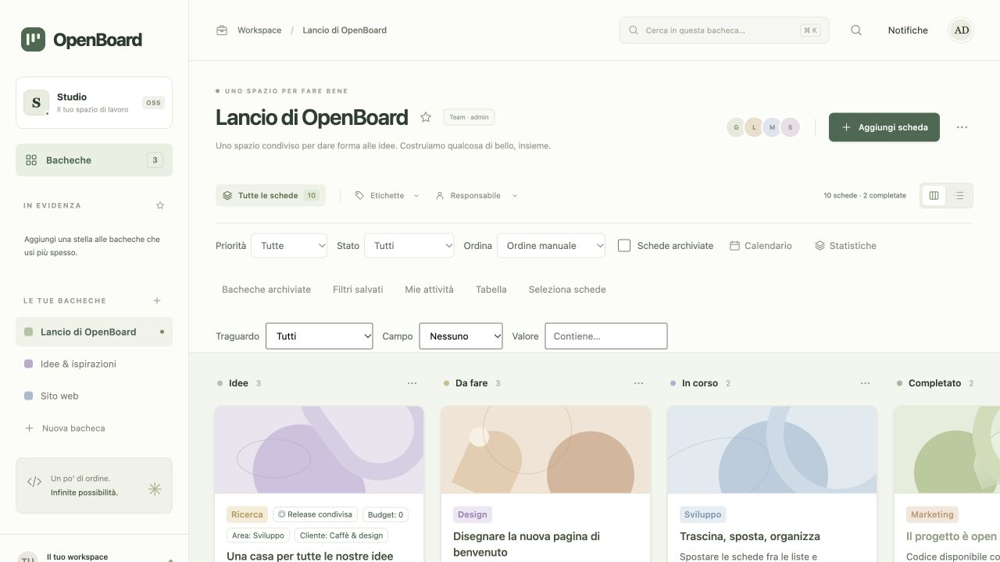
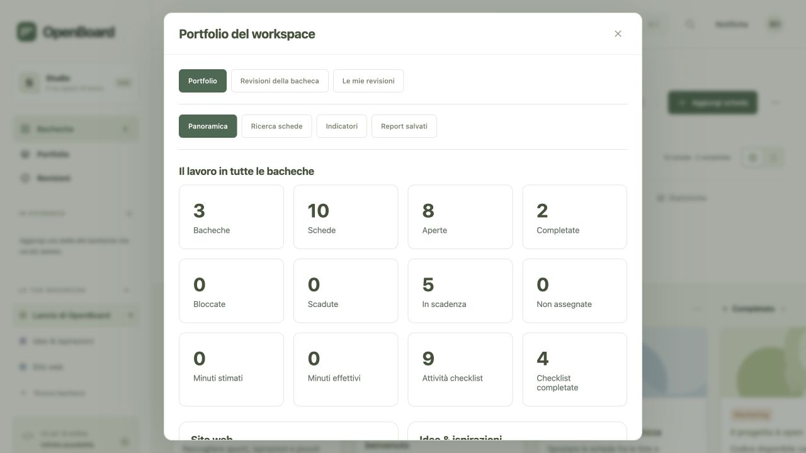

# OpenBoard

Un'app kanban open source ispirata a Trello, con **server in C**. Lo stack Docker separa **frontend statico e backend API autenticato**, **PostgreSQL** per i dati strutturati, **MongoDB** per i documenti JSON e **Nginx Proxy Manager** per HTTP/HTTPS. Per lo sviluppo locale è disponibile anche SQLite. L'interfaccia usa HTML, CSS e JavaScript senza framework, dipendenze npm o CDN.



## Avvio rapido

Con Docker Compose:

```sh
python3 scripts/init-env.py
docker compose up -d --build --wait
python3 scripts/bootstrap-local.py
```

Apri **http://openboard.localhost**. Il bootstrap locale crea i primi amministratori e il Proxy Host solo su un'istanza nuova, con password casuali in `.env.local-admin` (`0600`, escluso da Git). Il pannello Nginx Proxy Manager è su **http://127.0.0.1:81**. Per scegliere manualmente gli account o usare un dominio reale, segui la [guida di installazione](docs/DEPLOYMENT.md).

La cache SQLite dell'app viene ricostruita dai due database esterni. Le scritture vengono confermate dopo la persistenza dei documenti MongoDB e il commit PostgreSQL. Questa prima integrazione serializza le richieste e pubblica uno snapshot completo a ogni modifica: è adatta a installazioni pilota, con un limite di scalabilità documentato nella guida.

### Sviluppo locale

Servono un compilatore C11, `make`, SQLite con supporto JSON, OpenSSL libcrypto e `pkg-config`.

Su macOS servono gli strumenti della riga di comando di Xcode e OpenSSL con `pkg-config`, installabili tramite Homebrew:

```sh
xcode-select --install
brew install openssl@3 pkg-config
```

Su Debian/Ubuntu:

```sh
sudo apt-get install build-essential libsqlite3-dev libssl-dev pkg-config python3
```

Dalla cartella del progetto:

```sh
make
./build/openboard --public-url http://127.0.0.1:8090
# In un secondo terminale:
python3 scripts/dev-frontend.py
```

Apri **http://127.0.0.1:8090** e configura il primo amministratore. Al primo avvio vengono create tre bacheche dimostrative; le modifiche successive vengono salvate in `data/openboard.db`. Ferma i due processi con `Ctrl+C`. Il backend su `127.0.0.1:8080` espone soltanto API JSON; le richieste ai dati richiedono autenticazione. `--no-auth` abilita esplicitamente lo sviluppo senza account soltanto su loopback.

Puoi scegliere porta e database del backend:

```sh
./build/openboard --port 8080 --db data/personale.db --public-url http://127.0.0.1:8090
```

## Cosa puoi fare

- Creare, rinominare, personalizzare e rimuovere bacheche; aggiungerle ai preferiti.
- Aggiungere, rinominare e rimuovere colonne.
- Creare e modificare schede con descrizione, etichette multiple, priorità, scadenza, assegnatario, stima, copertina e checklist.
- Spostare e riordinare schede con il trascinamento oppure scegliendo lista e posizione; impostare limiti WIP.
- Cercare schede, applicare filtri e usare viste a colonne, elenco, calendario e statistiche.
- Definire campi personalizzati tipizzati, traguardi e linee guida; consultare una vista tabellare e report del carico.
- Registrare il tempo con data e nota, leggere report personali/per utente ed esportare il registro in CSV.
- Rispondere ai commenti, aggiungere reazioni, fissare aggiornamenti e conservare segnalibri personali.
- Collaborare con account individuali, ruoli, commenti, cronologia e aggiornamenti tra sessioni.
- Richiedere revisioni delle schede, assegnare revisori e raccogliere approvazioni o modifiche motivate.
- Consultare un portfolio fra bacheche, salvare report personali e confrontare ritardi, carico e avanzamento.
- Duplicare, archiviare e recuperare dal cestino; importare ed esportare bacheche in JSON.

Le preferenze dell'interfaccia rimangono nel browser; bacheche e schede rimangono nel database. L’esportazione OpenBoard versione 2 è importabile dall’interfaccia su una nuova bacheca. Il backup SQLite conserva anche account, commenti, cronologia e cestino.

## Struttura

```text
src/http.c          Trasporto API HTTP concorrente, limiti e configurazione
src/server.c        API di dominio, migrazioni e persistenza SQLite
src/auth.c          Account, sessioni e autorizzazioni
src/collaboration.c Notifiche, sottoscrizioni, allegati e strumenti personali
src/teamwork.c      Registri del tempo, conversazioni, reazioni e segnalibri
src/reviews.c       Richieste di revisione, voti, cronologia e inbox
src/portfolio.c     Ricerca fra bacheche, indicatori e report personali
src/cloud.c         PostgreSQL e MongoDB; cache SQLite ricostruibile
web/index.html      Struttura dell'interfaccia
web/styles.css      Stili e layout responsive
web/app.js          Interazioni e comunicazione con le API
web/planning.js     Campi, traguardi, report e collaborazione della 0.4
web/enterprise.js   Interfaccia per revisioni, portfolio e report della 0.5
compose.yaml        Backend C, frontend statico, PostgreSQL, MongoDB e proxy
tests/              Test di regressione, dominio, autenticazione e HTTP
Makefile            Compilazione e comandi di sviluppo
data/               Database locale, escluso dal controllo versione
build/              Eseguibile, escluso dal controllo versione
```

Il server usa socket POSIX e statement SQLite preparati. Espone soltanto API; non contiene né serve HTML, CSS o JavaScript. Il frontend statico è distribuito da un container separato. Nessuno dei due richiede Node.js a runtime. I dati iniziali vengono inseriti una volta sola per database.

La documentazione degli endpoint e dei campi si trova in [docs/API.md](docs/API.md).

## Verifica

```sh
make test
```

I test avviano il server su porte locali libere con database temporanei e verificano operazioni CRUD, migrazioni, conflitti concorrenti, idempotenza, permessi, sessioni e limiti HTTP. Non toccano il database personale. Le prove manuali nell'interfaccia sono documentate nell'elenco delle migliorie.

## Accesso condiviso

Gli account sono abilitati per impostazione predefinita. Per iniziare senza dati dimostrativi:

```sh
./build/openboard --no-demo --public-url http://127.0.0.1:8090
```

Apri il browser locale, configura il primo amministratore, poi crea gli utenti nel pannello di gestione. I ruoli disponibili sono amministratore, membro e osservatore. Le bacheche si condividono dal pannello Membri; i preferiti sono personali.

Per un proxy HTTPS sullo stesso host, configura anche l’origine pubblica, senza percorso né slash finale:

```sh
./build/openboard --auth --public-url https://board.example.com
```

Il processo locale ascolta su loopback. Il container usa esplicitamente `OPENBOARD_BIND=0.0.0.0` sulla rete privata, senza pubblicare la porta dell'app. Completa il setup prima di aggiungere il Proxy Host; la modalità senza account è destinata all’uso personale locale. I dettagli sono in [SECURITY.md](SECURITY.md).

## Funzioni della versione 0.2

Cestino con ripristino, archivio, duplicazione, priorità, etichette multiple, stima dell’impegno, limiti WIP, riordino liste, commenti e cronologia delle attività. L’interfaccia offre anche ricerca globale, statistiche, calendario, importazione JSON, bozze recuperabili, link diretti, tema scuro e densità configurabile. Le revisioni segnalano i conflitti fra sessioni.

L’elenco numerato dei 100 interventi, con stato e verifiche, è in [docs/MIGLIORIE_100.md](docs/MIGLIORIE_100.md).

## Funzioni della versione 0.3

Data di inizio, blocchi, tempo effettivo e timer manuale; assegnazioni a più utenti, attività personali e dipendenze fra schede. Template personali per schede e bacheche, filtri salvati e completamento/archiviazione multipla con controllo delle versioni.

Seguendo una bacheca o una scheda ricevi notifiche interne per gli aggiornamenti degli altri membri. Ogni scheda può conservare fino a 10 allegati attivi, di massimo 1 MiB ciascuno e 5 MiB complessivi. Gli allegati rimossi sono ripristinabili. Il pannello account permette di aggiornare il nome e revocare le altre sessioni.

Sono disponibili anteprima Markdown, esportazioni CSV/iCalendar e scorciatoie documentate nell'app. L'[elenco dei nuovi 100 interventi](docs/MIGLIORIE_200.md) prosegue la numerazione fino a 200. Le nuove API sono documentate in [produttività](docs/API_PRODUTTIVITA.md) e [collaborazione](docs/API_COLLABORAZIONE.md).

Le istruzioni per installazione, Docker Compose, systemd, nginx HTTPS, configurazione da ambiente, metriche e manutenzione sono in [docs/DEPLOYMENT.md](docs/DEPLOYMENT.md).

## Funzioni della versione 0.4

Terzo gruppo di 100 interventi: campi testo/numero/data/booleano/scelta, traguardi con avanzamento, priorità/etichette/traguardi multipli, linee guida e carico di lavoro. Registro del tempo recuperabile con totali e report CSV; commenti Markdown con risposte, reazioni ed evidenza, segnalibri personali, tabella e notifiche filtrate prima della paginazione.

L'[elenco numerato 201–300 con evidenze](docs/MIGLIORIE_300.md) descrive tutte le funzioni implementate. I contratti sono in [pianificazione](docs/API_PIANIFICAZIONE.md) e [tempo e conversazioni](docs/API_TEAMWORK.md). Lo schema locale passa a 5; l'import/export JSON v2 comprende definizioni personalizzate e traguardi. Il backup completo conserva anche account e dati di collaborazione.

## Funzioni della versione 0.5

Quarto gruppo di 100 interventi: richieste di revisione con più revisori, regola tutti/almeno uno, approvazioni e modifiche motivate, inbox personale, scadenze, cestino, cronologia e CSV. La revoca dei permessi invalida i voti e un successivo reinvito richiede una nuova decisione. Il richiedente non può approvare la propria richiesta.

Il portfolio raccoglie le bacheche accessibili, offre ricerca e filtri fra progetti, report personali fissabili ed esportazione CSV paginata. Gli indicatori mostrano attività giornaliera, ritardi, carico per persona, stima/tempo effettivo, limiti WIP, checklist, dipendenze e traguardi. Revisioni e report personali richiedono un account; i filtri salvati rispettano i permessi correnti.

L'[elenco completo 301–400 con verifiche](docs/MIGLIORIE_400.md) distingue API e interfaccia. I contratti sono in [revisioni](docs/API_REVISIONI.md) e [portfolio](docs/API_PORTFOLIO.md). Lo schema 6 conserva i dati precedenti; l'aggiornamento PostgreSQL/MongoDB 5 → 6 aggiunge le nuove tabelle senza riscrivere i documenti esistenti. Prima dell'aggiornamento seguire la [procedura di backup e migrazione](docs/DEPLOYMENT.md).



## Dati e backup

Il database iniziale viene migrato automaticamente: una copia `.pre-vN.bak` precede l’aggiornamento. I database con schema futuro non supportato vengono rifiutati. `--no-demo` disattiva i dati dimostrativi sui database nuovi.

Per creare un backup consistente, anche se un’altra istanza usa il database:

```sh
./build/openboard --db data/openboard.db --backup /percorso/backup.db
```

Per il ripristino arresta il servizio e sostituisci il database con una copia del backup verificato. Conserva l’originale finché il ripristino non è stato controllato. `make clean` elimina soltanto gli artefatti di compilazione.

Per i controlli della memoria e del comportamento indefinito:

```sh
make test-sanitize
```

Per verificare i formati prodotti dal frontend serve Node.js, usato soltanto nei test:

```sh
make test-frontend
```

Il server usa per impostazione predefinita 8 worker; `--workers 1..32` ne cambia il numero. `--quiet` disattiva i log HTTP. `/api/health`, `/api/ready` e `/api/version` permettono rispettivamente controlli di processo, database e versione.

## Contribuire

Vedi [CONTRIBUTING.md](CONTRIBUTING.md). Il codice è disponibile con licenza [MIT](LICENSE). OpenBoard è un progetto indipendente e non è affiliato a Trello o Atlassian.
