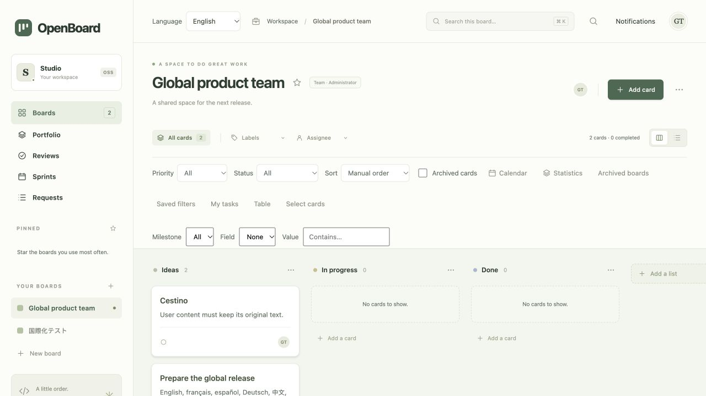
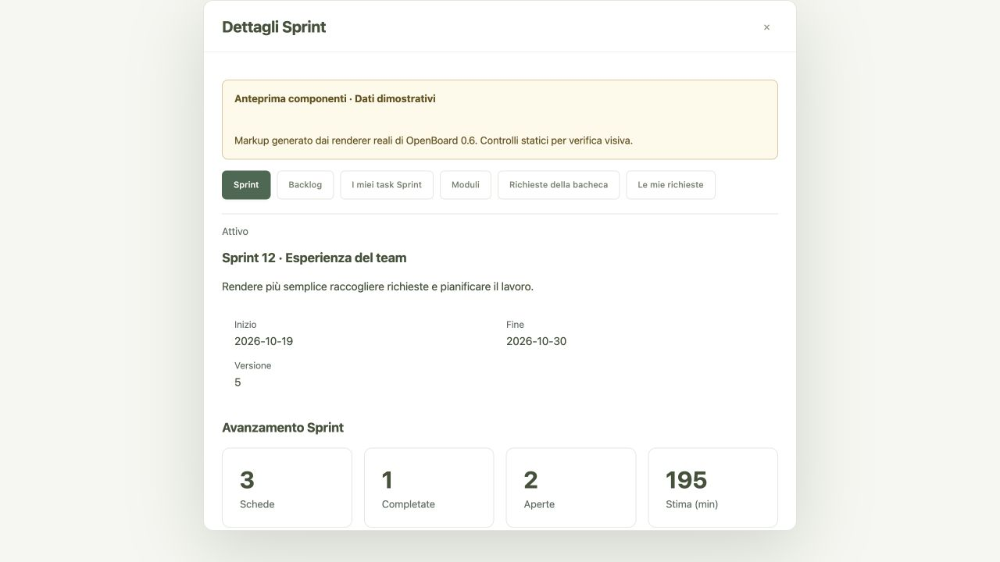

# OpenBoard

An open source kanban application inspired by Trello, powered by a **C backend**. The Docker stack separates the **static frontend and authenticated API**, with **PostgreSQL** for structured data, **MongoDB** for JSON documents, and **Nginx Proxy Manager** for HTTP/HTTPS. SQLite is also available for local development. The interface uses plain HTML, CSS, and JavaScript, with no frontend framework, npm dependencies, or CDN.



## Quick start

Start the Docker Compose stack:

```sh
python3 scripts/init-env.py
docker compose up -d --build --wait
python3 scripts/bootstrap-local.py
```

Open **http://openboard.localhost**. HTTP, HTTPS and the proxy administration console bind to loopback by default; network exposure requires an explicit `OPENBOARD_PUBLISH_IP=0.0.0.0` setting. On a fresh installation, the local bootstrap creates the first administrators and the proxy host, then saves randomly generated passwords in `.env.local-admin` (`0600`, excluded from Git). Nginx Proxy Manager is available at **http://127.0.0.1:81**. To set up accounts manually or use a real domain, follow the [deployment guide](docs/DEPLOYMENT.md).

The application rebuilds its SQLite cache from the two external databases. A write is acknowledged after its MongoDB documents have been persisted and the PostgreSQL transaction has committed. The current storage integration serializes requests and publishes a complete snapshot for each mutation. It is intended for pilot installations; the deployment guide documents this scalability limit.

### Local development

Requirements: a C11 compiler, `make`, SQLite with JSON support, OpenSSL libcrypto, and `pkg-config`. Python 3 runs the development frontend server and the backend tests.

On macOS, install the Xcode command line tools and the Homebrew packages:

```sh
xcode-select --install
brew install openssl@3 pkg-config
```

On Debian or Ubuntu:

```sh
sudo apt-get install build-essential libsqlite3-dev libssl-dev pkg-config python3
```

From the project directory:

```sh
make
./build/openboard --public-url http://127.0.0.1:8090
# In a second terminal:
python3 scripts/dev-frontend.py
```

Open **http://127.0.0.1:8090** and create the first administrator. A new database starts with three demonstration boards; subsequent changes are saved in `data/openboard.db`. Stop both processes with `Ctrl+C`. The backend at `127.0.0.1:8080` exposes JSON APIs only, and data endpoints require authentication. `--no-auth` explicitly enables account-free development on loopback only.

To select a backend port and database:

```sh
./build/openboard --port 8080 --db data/personal.db --public-url http://127.0.0.1:8090
```

## Security review

The [pre-publication security audit](docs/SECURITY_AUDIT_2026-10-16.md) records confirmed findings, fixes, regression tests and remaining dependency risks. Internet deployment requires HTTPS, private administration and review of the scanned image dependencies. The audit is not a security certification.

## Features

- Create, rename, customize, and delete boards; keep personal favorites.
- Add, rename, reorder, and remove columns.
- Create cards with descriptions, multiple labels, priorities, due dates, assignees, estimates, covers, and checklists.
- Move and reorder cards by dragging or choosing a list and position; enforce work-in-progress (WIP) limits.
- Search and filter cards; switch between kanban, list, calendar, and statistics views.
- Define typed custom fields, milestones, and board guidelines; use table and workload views.
- Log time with a date and note, review personal and per-user reports, and export work logs to CSV.
- Reply to comments, add reactions, pin updates, and keep personal bookmarks.
- Collaborate through individual accounts, roles, comments, activity history, and updates across sessions.
- Request card reviews, assign reviewers, and collect approvals or explained change requests.
- Browse a cross-board portfolio, save personal reports, and compare overdue work, workload, and progress.
- Plan sprints from the backlog, allocate team capacity, and capture daily progress.
- Build typed internal forms, triage incoming requests, and convert them into cards.
- Duplicate, archive, and restore items from the trash; import and export boards as JSON.

Interface preferences are stored in the browser; boards and cards are stored in the database. OpenBoard JSON export version 2 can be imported into a new board through the interface. A complete application backup also preserves accounts, comments, history, trash, and collaboration data. Board exports do not replace full backups.

## Languages

The interface supports **English, Italian, French, Spanish, German, Simplified Chinese, and Japanese**. OpenBoard detects a supported browser language on first use, with English as the fallback. An accessible language selector is available before and after login; your choice is saved locally in the browser. Changing the interface language preserves board content and other user-entered data. The backend API contract remains language-independent.

New boards create their initial lists in the selected language. Existing content keeps its original language. See the [translation guide](docs/INTERNATIONALIZATION.md) for catalogue maintenance, URL and storage fallback, and validation results.

## Project structure

```text
src/http.c          Concurrent HTTP API transport, limits, and configuration
src/server.c        Domain APIs, migrations, and SQLite persistence
src/auth.c          Accounts, sessions, and authorization
src/collaboration.c Notifications, subscriptions, attachments, and personal tools
src/teamwork.c      Work logs, conversations, reactions, and bookmarks
src/reviews.c       Review requests, decisions, history, and inbox
src/portfolio.c     Cross-board search, metrics, and personal reports
src/sprints.c       Sprints, backlog, capacity, and daily snapshots
src/intake.c        Internal forms, typed requests, and card conversion
src/cloud.c         PostgreSQL and MongoDB; rebuildable SQLite cache
web/index.html      Interface structure
web/styles.css      Styles and responsive layout
web/app.js          Interactions and API communication
web/i18n.js         Language detection, selection, and interface localization
web/locales.js      Translation catalogs
web/planning.js     Custom fields, milestones, reports, and collaboration (0.4)
web/enterprise.js   Reviews, portfolio, and report interface (0.5)
web/workflows.js    Sprint and request intake interface (0.6)
compose.yaml        C backend, static frontend, PostgreSQL, MongoDB, and proxy
tests/              Regression, domain, authentication, and HTTP tests
Makefile            Build and development commands
data/               Local database; excluded from version control
build/              Compiled binaries; excluded from version control
```

The server uses POSIX sockets and prepared SQLite statements. It exposes APIs only; it neither embeds nor serves HTML, CSS, or JavaScript. A separate container serves the static frontend. Neither component requires Node.js at runtime. Demonstration data is inserted once per database.

See the [API reference](docs/API.md) for endpoints and fields.

## Testing

```sh
make test
```

The tests start the server on available local ports with temporary databases. They cover CRUD operations, migrations, concurrent updates, idempotency, permissions, sessions, and HTTP limits without modifying your own database. The improvement checklists document manual interface checks.

Run memory and undefined-behavior checks:

```sh
make test-sanitize
```

Frontend tests require Node.js, which is used for testing only:

```sh
make test-frontend
```

## Team access

Accounts are enabled by default. To start without demonstration data:

```sh
./build/openboard --no-demo --public-url http://127.0.0.1:8090
```

Open the local frontend, create the first administrator, then add users in the administration panel. Available roles are administrator, member, and observer. Share boards through the Members panel; favorites remain personal.

For an HTTPS proxy on the same host, configure the public origin without a path or trailing slash:

```sh
./build/openboard --auth --public-url https://board.example.com
```

The local process listens on loopback. The container explicitly sets `OPENBOARD_BIND=0.0.0.0` on its private network and does not publish the application port. Complete account setup before adding the proxy host. Account-free mode is intended for local personal use. See [SECURITY.md](SECURITY.md) for details.

## Version 0.2

Trash and restore, archives, duplication, priorities, multiple labels, effort estimates, WIP limits, list ordering, comments, and activity history. The interface also adds global search, statistics, a calendar, JSON import, recoverable drafts, direct links, dark mode, and configurable density. Revision checks report conflicts between sessions.

The [numbered checklist of 100 improvements](docs/MIGLIORIE_100.md) records implementation status and verification.

## Version 0.3

Start dates, blockers, actual time, and a manual timer; multiple assignees, personal tasks, and card dependencies. Personal card and board templates, saved filters, and bulk completion and archiving with version checks.

Follow a board or card to receive internal notifications when other members make changes. Each card supports up to 10 active attachments, with a maximum of 1 MiB per file and 5 MiB total. Deleted attachments can be restored. Account settings let users update their display name and revoke other sessions.

Markdown previews, CSV/iCalendar exports, and in-app keyboard shortcut documentation are also available. The [second checklist](docs/MIGLIORIE_200.md) extends the improvement list to 200. See the [productivity](docs/API_PRODUTTIVITA.md) and [collaboration](docs/API_COLLABORAZIONE.md) API references.

The [deployment guide](docs/DEPLOYMENT.md) covers installation, Docker Compose, systemd, nginx HTTPS, environment configuration, metrics, and maintenance.

## Version 0.4

The third set of 100 improvements adds text, number, date, boolean, and choice fields; milestone progress; bulk priority, label, and milestone changes; board guidelines; and workload reporting. Restorable work logs provide totals and CSV reports. Markdown comments support replies, reactions, and pinning. Personal bookmarks, a table view, and notifications filtered before pagination complete this release.

The [201–300 checklist with evidence](docs/MIGLIORIE_300.md) describes the implemented features. API contracts are documented under [planning](docs/API_PIANIFICAZIONE.md) and [time tracking and conversations](docs/API_TEAMWORK.md). Local database schema version 5 preserves previous data. JSON import/export version 2 includes custom field definitions and milestones; complete backups also preserve accounts and collaboration data.

## Version 0.5

The fourth set of 100 improvements introduces review requests with multiple reviewers, all-reviewer or any-reviewer approval rules, explained decisions, personal inboxes, deadlines, trash, history, and CSV exports. Revoking access invalidates a reviewer's decision, and a subsequent invitation requires a new decision. Requesters cannot approve their own requests.

The portfolio brings accessible boards together with cross-project search, filters, pinnable personal reports, and paginated CSV exports. Metrics cover daily activity, overdue work, workload per person, estimates and actual time, WIP limits, checklists, dependencies, and milestones. Reviews and personal reports require an account; saved filters respect current permissions.

The [301–400 checklist with verification](docs/MIGLIORIE_400.md) distinguishes API and interface work. See the [reviews](docs/API_REVISIONI.md) and [portfolio](docs/API_PORTFOLIO.md) contracts. Schema version 6 preserves existing data; the PostgreSQL/MongoDB upgrade from 5 to 6 adds tables without rewriting existing documents. Follow the [backup and migration procedure](docs/DEPLOYMENT.md) before upgrading.


## Version 0.6

The fifth set of 100 improvements adds sprints with goals and dates, one active sprint per board, single and bulk backlog planning, per-person capacity, comparisons against remaining effort, daily snapshots, personal tasks, history, and CSV exports. Closing a sprint retains unfinished cards and historical membership. Snapshots are captured explicitly; previous days are not reconstructed from invented data.

Internal forms collect text, numbers, dates, booleans, and choices. Each request retains the field schema used at submission, so later form changes do not alter the meaning of previous answers. Personal and board inboxes support triage, notes, trash, and atomic conversion into a card while enforcing permissions and WIP limits. Forms require an account and current board membership, including when published.

The [401–500 checklist](docs/MIGLIORIE_500.md) documents API and interface changes and their verification. See the [sprints and capacity](docs/API_SPRINT.md) and [forms and requests](docs/API_RICHIESTE.md) contracts. Schema version 7 adds tables, indexes, and triggers. External storage supports upgrades from 5 to 7 and from 6 to 7, preserving previous rows and JSON references. Follow the [upgrade and backup procedure](docs/DEPLOYMENT.md).



## Data and backups

Local databases are migrated automatically, with a `.pre-vN.bak` copy created before an upgrade. Unsupported future schema versions are rejected. `--no-demo` disables demonstration data for new databases.

To create a consistent backup of a local SQLite database, including while another instance is using it:

```sh
./build/openboard --db data/openboard.db --backup /path/to/backup.db
```

To restore a local database, stop the service and replace the database with a verified backup. Keep the original until the restoration has been checked. `make clean` removes build artifacts only.

For the Docker deployment with PostgreSQL and MongoDB, create a complete application snapshot:

```sh
python3 scripts/backup.py
```

This backup includes structured data and referenced JSON documents, rehydrated into a consistent SQLite snapshot. Restore external storage into a fresh pair of empty databases using the [documented procedure](docs/DEPLOYMENT.md). PostgreSQL and MongoDB form one application dataset; an isolated dump of either database is not a complete backup. Proxy configuration, certificates, and deployment secrets require their own backups.

The server runs eight workers by default; use `--workers 1..32` to change the count. `--quiet` disables HTTP logs. `/api/health`, `/api/ready`, and `/api/version` expose process health, database readiness, and version information, respectively.

## Contributing

See [CONTRIBUTING.md](CONTRIBUTING.md). OpenBoard is released under the [MIT license](LICENSE). It is an independent project and is not affiliated with Trello or Atlassian.
