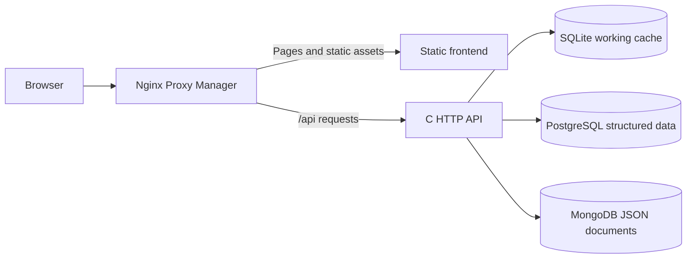

# Architecture

OpenBoard is a self-hosted kanban application with a C backend and a separate static HTML, CSS and JavaScript frontend. All application data reaches the browser through authenticated JSON APIs on the same origin. The current implementation targets evaluation and small-team pilots; it does not claim enterprise feature parity or demonstrated high availability.

## Components and responsibilities

| Component | Responsibility | Main sources |
| --- | --- | --- |
| C backend | HTTP parsing, validation, authentication, board permissions and application operations | `src/server.c`, `src/http.c`, `src/auth.c`, other `src/` modules |
| Static frontend | Page layout, accessible controls, local drafts, language selection and API interaction | `web/` |
| External storage adapter | Cache reconstruction, revision coordination, SQL publication and JSON persistence | `src/cloud.c` |
| Local development frontend | Serves static assets and proxies APIs to the local backend | `scripts/dev-frontend.py` |
| Container ingress | TLS termination, static/API routing, client IP forwarding and abuse limits | `Dockerfile.npm`, `deploy/npm/` |
| Operations | Environment generation, initial setup, backups and deployment checks | `scripts/`, `compose.yaml` |

The backend serves API responses, not frontend assets. The production frontend receives no database credentials and does not proxy APIs. NPM routes `/api` directly to the backend and pages to the static frontend. Local development instead uses the Python frontend server to present both under one origin.

## Storage modes

**Local mode** uses a SQLite file as the authoritative database. This is the native development default when neither external connection variable is set. SQLite migrations preserve a private pre-migration backup.

**Compose mode** sets both `OPENBOARD_POSTGRES_URL` and `OPENBOARD_MONGODB_URI`. PostgreSQL holds structured rows and references to immutable, content-addressed JSON documents in MongoDB. SQLite becomes a reconstructible working cache in the app container's `/tmp`; it is not the persistent database and must not be backed up by copying a live cache.

Before a data operation, the backend takes the shared PostgreSQL lock and reconstructs its cache if the external revision has changed. JSON documents are written before the SQL transaction publishes references and the next revision. Only successful external publication acknowledges a write. Failed persistence invalidates the cache and returns `503`. Documents left unreferenced after a failure do not become application state.

This design coordinates processes but serializes data operations. It saves row snapshots, including changes caused by authenticated session activity. Additional HTTP workers do not provide parallel database writes. Incremental storage, workload measurements and a tested availability strategy remain future work; see [Deployment](DEPLOYMENT.md#persistence-and-consistency).

## Identity and trust boundaries

Authentication is enabled by default. Session cookies identify users; authenticated modifying requests require CSRF protection, and Host/Origin validation constrains browser access. API handlers enforce current global and board permissions; hiding a control in the frontend is not an authorization boundary. Protected writes recheck the session and role in their transaction. Idempotent replays also check current permissions. The frontend isolates asynchronous responses across account changes.

The backend obtains the real TCP peer. It accepts `X-Real-IP` only from one explicitly configured `OPENBOARD_TRUSTED_PROXY` IPv4 peer, and requires a single valid numeric client address. Other forwarded headers do not establish identity. NPM overwrites client IP headers, applies authentication and connection limits, and has a separate limiter for its administration authentication. Compose reserves its static address outside the dynamic frontend IP pool. Adding another proxy or CDN requires a deliberate trust-chain review.

Only NPM publishes host ports. Public HTTP/HTTPS bind to loopback by default, and NPM administration remains on loopback even for a public deployment. Backend and database ports are not published; the database network is internal. The app and frontend use unprivileged users, read-only filesystems and temporary filesystems. The deployment preflight checks the effective running configuration rather than assuming that a configuration file has been applied.

## Extension and operations

Add a feature through its C handler and data schema, expose a documented API, then implement the corresponding frontend interaction. The [API guide](API.md) describes request contracts; [Contributing](../CONTRIBUTING.md) describes builds and verification. Localized UI and error catalogues are covered in [Internationalization](INTERNATIONALIZATION.md).

Schema 7 supports explicit external upgrades from schemas 5 and 6. Database major-version upgrades are separate migrations. A full application backup rehydrates both external stores into one SQLite snapshot; NPM configuration, certificates and deployment secrets need their own protected backups. Follow the [deployment and restore procedures](DEPLOYMENT.md), and consult the [security policy](../SECURITY.md) and [remediation report](SECURITY_REMEDIATION_2026-10-16.md) before internet exposure.
