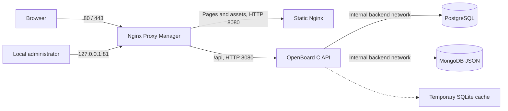

# Docker Compose deployment

OpenBoard separates its static Nginx frontend from its authenticated C API backend. PostgreSQL stores structured rows and properties, MongoDB stores JSON documents, and Nginx Proxy Manager (NPM) handles HTTP/HTTPS ingress and certificates. The frontend contains public assets and HTTP calls; database credentials, queries and persistence stay in the backend. The backend image includes the real `libpq` and `libmongoc` C drivers. SQLite is a reconstructible local cache in `/tmp`, without an application data volume.



Only NPM publishes host ports, bound to `127.0.0.1` by default. The frontend receives no database credentials and does not proxy API requests. NPM reaches frontend and backend separately on the `frontend` network; the application and databases share the internal `backend` network. NPM administration stays on loopback. The app runs as UID/GID `10001`, with a read-only filesystem, no Linux capabilities and a 256 MiB `tmpfs` for its cache and temporary files. The frontend runs as UID/GID `101`, with a read-only filesystem and a small `tmpfs` for Nginx PID and temporary files. PostgreSQL, MongoDB and NPM use separate named volumes. Application database users are not global administrators.

## Requirements and images

Start Docker Engine or Docker Desktop. You also need Docker Compose with `depends_on.condition: service_healthy` support, Python 3 for the local scripts and available HTTP/HTTPS ports. The application builds on Debian Trixie with `libpq-dev` and [`libmongoc-dev`](https://packages.debian.org/trixie/libmongoc-dev).

Compose builds five project images: `openboard:0.6.1`, `openboard-frontend:0.6.1`, `openboard-postgres:0.6.1`, `openboard-mongo:0.6.1` and `openboard-proxy:0.6.1`. The database and proxy images pin PostgreSQL 17.11, MongoDB 8.0.34 and NPM 2.16.0 bases by digest, update distribution packages and rebuild affected components. They retain the database major versions and data formats. The first build also downloads Go sources and dependencies, so subsequent builds are faster. The [remediation report](SECURITY_REMEDIATION_2026-10-16.md) records versions, verification and residual findings. Review image pins and repeat scans when updating dependencies.

The frontend uses `nginxinc/nginx-unprivileged:1.30.6-alpine-slim` with distribution updates and starts Nginx directly with temporary directories in `/tmp`. PostgreSQL 17 persists in `/var/lib/postgresql/data`; upgrading to PostgreSQL 18 requires a migration plan. See the [PostgreSQL image documentation](https://hub.docker.com/_/postgres) and the [frontend image documentation](https://github.com/nginx/docker-nginx-unprivileged/blob/main/README.md).

## First local start

Run from the repository root:

```sh
python3 scripts/init-env.py
docker compose config --quiet
docker compose up -d --build --wait
```

HTTP and HTTPS bind to loopback: `OPENBOARD_PUBLISH_IP=127.0.0.1`. A public server requires an explicit `OPENBOARD_PUBLISH_IP=0.0.0.0` and a matching HTTPS origin. For a fresh installation, for example, use `python3 scripts/init-env.py --publish-ip 0.0.0.0 --public-url https://board.example.org`; complete administrator setup and TLS before opening the firewall.

`init-env.py` creates `.env` with permissions `0600` and four distinct random 256-bit passwords. It does not print secrets or overwrite an existing file. `.env` is excluded from Git and the Docker build context. Passwords in `.env.example` are deliberately empty; Compose refuses to start until they are set. Use `docker compose config --quiet` in shared logs: expanded configuration includes connection strings.

If standard ports are occupied:

```sh
python3 scripts/init-env.py --http-port 8088 --https-port 8443 --admin-port 8181
```

This generates the local origin `http://openboard.localhost:8088`. If `.env` already exists, edit its ports and public origin together.

### Automatic local setup

Complete both administrator accounts and the local proxy host:

```sh
python3 scripts/bootstrap-local.py
python3 scripts/check-deployment.py
```

The bootstrap uses the local official NPM and OpenBoard APIs, generates distinct random passwords and saves them in `.env.local-admin` with permissions `0600`, without printing them. The accounts are `admin` for OpenBoard and `admin@openboard.localhost` for NPM. It creates the first OpenBoard administrator before publishing the proxy host. Then `http://openboard.localhost` serves the frontend and authenticated APIs; NPM administration remains at `http://127.0.0.1:81`.

This bootstrap supports only `http://openboard.localhost[:port]`. Running it again reuses private credentials without changing passwords, accounts or hosts. An existing installation with unknown credentials, or a different local proxy host configuration, stops the bootstrap without overwriting anything. It does not set `INITIAL_ADMIN_*` in the container. Use manual setup for a public domain or your own account names and passwords.

### Manual setup

```sh
python3 scripts/setup-admin.py
```

`setup-admin.py` creates the first OpenBoard administrator through a local `docker compose exec`. It prompts for name, username and password without displaying the password; it does not modify existing accounts or print cookies or tokens. Run it **before adding a public Proxy Host** so the first visitor cannot claim the instance. The Compose image enables accounts and permissions and starts without demonstration data.

### Configure Nginx Proxy Manager

1. Open `http://127.0.0.1:81` (or your chosen administration port) and complete the initial NPM account setup.
2. Select **Hosts → Proxy Hosts → Add Proxy Host**. Set Domain Names to `openboard.localhost`, Scheme to `http`, Forward Hostname to `frontend` and Forward Port to `8080`. The domain field excludes the scheme and port.
3. Leave **Custom locations** empty. Paste the complete API block below into **Advanced**. NPM sends assets to `frontend` and API requests directly to `app`.
4. Save and open `http://openboard.localhost`. For custom ports, use the origin configured in `.env`.
5. Sign in with the OpenBoard administrator created earlier. Check that `/api/auth/session` returns JSON and `/` returns the frontend.

Use the contents of [`deploy/npm/openboard-api.conf`](../deploy/npm/openboard-api.conf) in **Advanced**:

```nginx
# Paste this entire file into the OpenBoard NPM Proxy Host Advanced field.
# The OpenBoard proxy image supplies the shared zones and HTTP 429 status.
location ^~ /api/ {
    resolver 127.0.0.11 valid=10s ipv6=off;
    set $openboard_api app:8080;
    client_max_body_size 2m;
    limit_conn openboard_api_clients 8;
    limit_conn openboard_api_total 32;
    proxy_set_header Host $http_host;
    proxy_set_header X-Real-IP $remote_addr;
    proxy_set_header X-Forwarded-For $remote_addr;
    proxy_set_header X-Forwarded-Proto $scheme;
    proxy_pass http://$openboard_api;
}

location = /api/auth/login {
    limit_req zone=openboard_auth burst=10 nodelay;
    resolver 127.0.0.11 valid=10s ipv6=off;
    set $openboard_api app:8080;
    client_max_body_size 2m;
    limit_conn openboard_api_clients 8;
    limit_conn openboard_api_total 32;
    proxy_set_header Host $http_host;
    proxy_set_header X-Real-IP $remote_addr;
    proxy_set_header X-Forwarded-For $remote_addr;
    proxy_set_header X-Forwarded-Proto $scheme;
    proxy_pass http://$openboard_api;
}

location = /api/auth/setup {
    limit_req zone=openboard_auth burst=10 nodelay;
    resolver 127.0.0.11 valid=10s ipv6=off;
    set $openboard_api app:8080;
    client_max_body_size 2m;
    limit_conn openboard_api_clients 8;
    limit_conn openboard_api_total 32;
    proxy_set_header Host $http_host;
    proxy_set_header X-Real-IP $remote_addr;
    proxy_set_header X-Forwarded-For $remote_addr;
    proxy_set_header X-Forwarded-Proto $scheme;
    proxy_pass http://$openboard_api;
}

location = /api/auth/password {
    limit_req zone=openboard_auth burst=10 nodelay;
    resolver 127.0.0.11 valid=10s ipv6=off;
    set $openboard_api app:8080;
    client_max_body_size 2m;
    limit_conn openboard_api_clients 8;
    limit_conn openboard_api_total 32;
    proxy_set_header Host $http_host;
    proxy_set_header X-Real-IP $remote_addr;
    proxy_set_header X-Forwarded-For $remote_addr;
    proxy_set_header X-Forwarded-Proto $scheme;
    proxy_pass http://$openboard_api;
}
```

`proxy_pass` without a path preserves `/api/...` and its query string. `$http_host` preserves the domain and port, including nonstandard public ports. The Docker resolver and upstream variable let Nginx refresh the `app` address after container recreation. See the Nginx [`proxy_pass`](https://nginx.org/en/docs/http/ngx_http_proxy_module.html#proxy_pass) and [`resolver`](https://nginx.org/en/docs/http/ngx_http_core_module.html#resolver) directives. Exact authentication locations apply a per-client rate limit and share connection limits with other API routes. Keep these blocks and avoid additional API locations that bypass their controls. See [NPM 2.16.0 location configuration](https://github.com/NginxProxyManager/nginx-proxy-manager/blob/v2.16.0/backend/templates/_location.conf).

NPM 2.16.0 displays its setup wizard when no users exist and no initial credentials are configured. This stack uses that path instead of a shared administrator password. The `/data` and `/etc/letsencrypt` volumes retain proxy configuration and certificates. See [NPM setup](https://nginxproxymanager.com/setup/) and the [2.16.0 initialization implementation](https://github.com/NginxProxyManager/nginx-proxy-manager/blob/v2.16.0/backend/setup.js).

### Proxy address and configuration upgrades

`OPENBOARD_FRONTEND_SUBNET=172.30.240.0/24`, `OPENBOARD_FRONTEND_IP_RANGE=172.30.240.128/25` and `OPENBOARD_PROXY_IP=172.30.240.2` reserve the NPM address. Dynamic allocation uses the upper half of the subnet, keeping the proxy outside that pool and avoiding startup conflicts. The backend trusts only this peer for `X-Real-IP`; NPM overwrites the header with its TCP client address. Browser-supplied headers cannot select a new authentication quota. Private networks and CDN headers are not implicitly trusted.

If this subnet overlaps an existing network, choose another pair with `init-env.py --frontend-subnet ... --proxy-ip ...` on a fresh installation. For an existing installation, update all three variables consistently before recreating its network. Plan for the resulting interruption and retain the volumes.

For a local installation created by the previous bootstrap, back up the data, update the images and run:

```sh
python3 scripts/bootstrap-local.py --upgrade-proxy
python3 scripts/check-deployment.py
```

The upgrade recognizes only the exact legacy configuration generated by this project. It retains the proxy host ID and reuses existing administrator accounts. It refuses manually changed configurations: update **Advanced** using `deploy/npm/openboard-api.conf` without resetting users or passwords. Ordinary bootstrap reruns remain strictly idempotent.

### Public domain and TLS

Before exposure, read the [remediation report](SECURITY_REMEDIATION_2026-10-16.md), including remaining image findings. Set `OPENBOARD_PUBLISH_IP=0.0.0.0` and, for example, `OPENBOARD_PUBLIC_URL=https://board.example.org` in `.env`. Point DNS at the host and use that domain in the Proxy Host. Request a Let's Encrypt certificate in **SSL** and enable **Force SSL**. `.localhost` is for local evaluation and cannot receive a public certificate. Recreate the app after changing its public origin:

```sh
docker compose up -d app npm
```

The exact public origin controls Host and Origin validation and Secure cookies. Include any nonstandard public port. NPM forwards the original host to the API and frontend; keep it instead of `app:8080`. The backend serves no HTML, CSS, JavaScript or project files. Direct frontend requests to `/api` return `404`. For attachments of up to 1 MiB, both the API proxy block and backend allow JSON request bodies of up to 2 MiB.

After completing both administrator setups and the certificate configuration, run:

```sh
python3 scripts/check-deployment.py
```

The preflight reads Compose without printing secrets. It checks live container port bindings, complete `nginx -T` configuration, the trusted proxy and anonymous responses. For HTTPS, it verifies the certificate with SNI and a trusted CA over a loopback connection and requires HTTP redirection to the exact public origin. It performs no login or certificate requests. `--config-only` does not verify runtime readiness. With a public HTTPS port other than 443, configure NPM's redirect to retain that port: standard **Force SSL** alone may omit it, which the preflight rejects.

Keep NPM administration private on a remote server. For example, use `ssh -L 8181:127.0.0.1:81 user@server`, then open `http://127.0.0.1:8181` locally.

## Persistence and consistency

PostgreSQL holds structured rows. JSON columns, including checklists, labels, custom fields, templates, filters and idempotency records, become immutable content-addressed MongoDB documents; PostgreSQL retains their references. Publication writes the documents before committing the SQL transaction that makes them visible. An unreferenced MongoDB document left after a failure does not change application state.

Before a data operation, the application acquires a PostgreSQL lock shared across processes, refreshes its cache if the external revision changed and then executes the API operation. Writes are acknowledged after external persistence succeeds. A storage failure returns `503` and invalidates the cache, which is reconstructed on the next request. Accounts, sessions, permissions and idempotency records also persist. Recreating the app container does not delete database contents.

External storage accepts JSON nesting up to 90 levels and rejects keys containing NUL. Requests exceeding these constraints return `400` before publication. Malformed JSON and literal NUL in request bodies are also request errors; `503` means storage unavailability. The default HTTP body limit is 2 MiB, and JSON requests must use `application/json`.

The current implementation serializes data operations and saves a row snapshot on each change, including authenticated reads that update session `last_seen`. It targets evaluation and small-team pilots. Before a large enterprise workload, measure your real dataset, introduce incremental persistence and plan availability for both databases. More HTTP workers do not make these transactions parallel. The 256 MiB `tmpfs` must hold cache, WAL and temporary files; increase it based on measured use and do not treat it as permanent storage.

## Upgrade to version 0.6

Version 0.6 uses schema 7. Before migrating an older local database, SQLite mode creates a private `*.pre-vN.bak` backup, such as `.pre-v6.bak` for a version 0.5 database. Existing data is retained.

External storage explicitly supports additive schema upgrades 5 → 7 and 6 → 7. Revisions, votes, reports and existing JSON document references are retained. First create and verify a full backup using the running version. Stop every application replica, build the 0.6 images and start the new app and frontend:

```sh
python3 scripts/backup.py
docker compose stop app
docker compose build app frontend
docker compose up -d --wait app frontend
```

The new application acquires the PostgreSQL lock, adds tables, reconstructs and checks the cache against existing data, then updates schema and revision in the same SQL transaction. A missing MongoDB document prevents the upgrade: the new tables and version change are rolled back. The migration does not rewrite previous rows or JSON references. An old application replica still running rejects requests after the schema changes rather than overwriting newer tables.

Check `/api/version`, `/api/ready`, existing-account sign-in, portfolio, reviews, sprints and forms. To roll back after migration, restore the backup into a new pair of empty databases as described below. Other external schema jumps are not inferred automatically, and future schemas are rejected. PostgreSQL, MongoDB and NPM volumes remain persistent.

## Full backup

```sh
python3 scripts/backup.py
```

The script runs `--backup` with a separate temporary cache under the same external lock as API operations, then copies a complete SQLite snapshot into `backups/` with permissions `0600`. It includes SQL rows and rehydrated MongoDB JSON, users, sessions, comments, attachments and metadata. A board's JSON export does not replace this full backup. Use `--output /path/to/backup.sqlite3` for another destination; existing files are not overwritten. Protect the backup like the databases, copy it to secure storage and verify restoration.

To check a copy offline:

```sh
./build/openboard --db backups/openboard-COPY.sqlite3 --integrity-check
```

Run this local command without `OPENBOARD_POSTGRES_URL` and `OPENBOARD_MONGODB_URI`, so it checks the offline file. For native database dumps, stop every writing app, capture PostgreSQL and MongoDB together, then restart. A PostgreSQL-only dump may reference absent MongoDB documents; treat the two stores as one backup unit.

Also retain `.env` in your secret-management system and back up NPM volumes to recover proxy administrator access, configuration and certificates. The application backup excludes NPM.

### Restore or import from SQLite

Use a **new instance with empty PostgreSQL and MongoDB databases**. Retain the old instance until verification completes. Database users are created only on new volumes; changing a password in `.env` does not change an existing user's password. See [PostgreSQL initialization](https://hub.docker.com/_/postgres) and [MongoDB initialization](https://hub.docker.com/_/mongo).

Start only the databases, then import the snapshot from the host through stdin:

```sh
docker compose up -d --wait postgres mongo
docker compose run --rm -T --entrypoint /bin/sh app -c 'umask 077; cat > /tmp/restore.db; exec /usr/local/bin/openboard --db /tmp/restore.db --backup /tmp/restore-check.sqlite3' < backups/openboard-SNAPSHOT.sqlite3
docker compose up -d --wait app frontend npm
```

The bootstrap publishes the file contents only when PostgreSQL storage is empty. If storage is already initialized, external state takes precedence; this command does not overwrite an existing installation. Do not start an empty app against the new storage first, because that initializes it. Restore NPM or recreate its Proxy Host, then verify accounts, cards, custom fields, attachments and time entries. Full backups also restore sessions; revoke them through account administration when the incident requires it.

## Native deployment and previous configurations

`deploy/openboard.service` starts only the authenticated C backend on `127.0.0.1:8080`. Nginx separately serves static assets and proxies `/api/` to the backend. The unit no longer uses `OPENBOARD_WEB_ROOT`, and the CLI option `--web-root` has been removed. Update old environment files that contain it: the frontend is a separate process.

Authentication is enabled by default. `--no-auth` or `OPENBOARD_AUTH=false` are allowed only with a loopback bind for local development. Compose uses `OPENBOARD_AUTH=true` and `OPENBOARD_BIND=0.0.0.0`. CLI options override environment variables. Setting both `OPENBOARD_POSTGRES_URL` and `OPENBOARD_MONGODB_URI` enables separate external databases; with both absent, the backend uses local SQLite. A protected `/etc/openboard.env`, read by systemd, can provide native connection strings. A native reverse proxy must match `--trusted-proxy` to its exact peer address; see [`deploy/nginx.conf.example`](../deploy/nginx.conf.example).

To transfer an older SQLite database, follow the import procedure above with new empty databases. The copied database migrates to the current schema before publication. `--diagnostics`, `--integrity-check` and `--checkpoint` operate on offline SQLite files and refuse execution with external storage enabled. `--backup` supports complete external snapshots; use a temporary cache separate from the active server cache.

## Routine operations

```sh
docker compose ps
docker compose logs --tail 100 app
docker compose stop
docker compose start
```

The frontend healthcheck requests `/health`; the app healthcheck requests `/api/ready` using the Host from its public origin. Database healthchecks authenticate as the application user. `stop` and `down` retain volumes. `down --volumes` deletes databases and NPM data, so it is not an update command. To update, create and verify a backup, build the new images, run `docker compose up -d --build --wait` and check core workflows. Database major-version upgrades need dedicated migration procedures.

For common startup and proxy failures, see [Troubleshooting](TROUBLESHOOTING.md).
