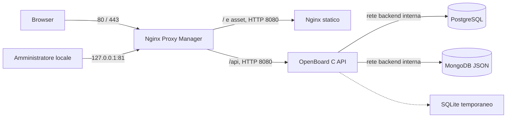

# Deployment Docker Compose con PostgreSQL, MongoDB e Nginx Proxy Manager

Questo stack separa il frontend statico Nginx dal backend C con API autenticate. PostgreSQL conserva righe e proprietà strutturate, MongoDB i documenti JSON e Nginx Proxy Manager (NPM) gestisce ingressi HTTP/HTTPS e certificati. Il frontend contiene soltanto asset pubblici e chiamate HTTP: credenziali database, query e persistenza applicativa restano nel backend. I driver C reali `libpq` e `libmongoc` vengono compilati nell'immagine. SQLite è una cache locale ricostruibile in `/tmp`, senza volume persistente dell'app.



Solo NPM pubblica porte dell'host. Il frontend non riceve variabili o credenziali database e non inoltra richieste API. NPM raggiunge separatamente frontend e backend sulla rete `frontend`; app e database comunicano sulle reti Docker; `backend` è interna. La gestione NPM resta su loopback. L'app usa UID/GID `10001`, filesystem di sola lettura, nessuna capability Linux e un `tmpfs` da 256 MiB per cache e file temporanei. Il frontend usa UID/GID `101`, filesystem di sola lettura e un piccolo `tmpfs` per PID e file temporanei Nginx. PostgreSQL, MongoDB e NPM hanno volumi nominati distinti. Gli utenti database dell'app non sono amministratori globali.

## Requisiti e immagini

Servono Docker Engine/Desktop avviato, Docker Compose con supporto a `depends_on.condition: service_healthy`, Python 3 per gli script locali e porte HTTP/HTTPS libere. L'app si compila in Debian Trixie usando `libpq-dev` e [`libmongoc-dev`](https://packages.debian.org/trixie/libmongoc-dev).

Le immagini sono `postgres:17-trixie`, `mongo:8.0-noble`, `jc21/nginx-proxy-manager:2.16.0` e, per gli asset, `nginxinc/nginx-unprivileged:1.30.6-alpine-slim`. Il frontend avvia Nginx direttamente con PID e directory temporanee in `/tmp`. [Immagine Nginx senza privilegi](https://github.com/nginx/docker-nginx-unprivileged/blob/main/README.md). Le prime due seguono aggiornamenti della versione selezionata; per distribuzioni riproducibili registrare i digest approvati. PostgreSQL 17 persiste in `/var/lib/postgresql/data`; PostgreSQL 18 cambia percorso e richiede un piano di migrazione, quindi cambiare soltanto il tag non è un aggiornamento sufficiente. [Documentazione dell'immagine PostgreSQL](https://hub.docker.com/_/postgres), [tag ufficiali MongoDB](https://github.com/docker-library/docs/tree/master/mongo#supported-tags-and-respective-dockerfile-links).

## Primo avvio locale

Dalla directory del progetto:

```sh
python3 scripts/init-env.py
docker compose config --quiet
docker compose up -d --build --wait
```

`init-env.py` crea `.env` con permessi `0600` e quattro password casuali distinte da 256 bit. Non stampa i segreti e non sovrascrive un file esistente. `.env` è escluso da Git e dal contesto Docker. `.env.example` lascia intenzionalmente vuote le password: Compose rifiuta l'avvio finché non sono state configurate. Non usare `docker compose config` senza `--quiet` in log condivisi: la configurazione espansa contiene le stringhe di connessione.

Se le porte standard sono già occupate:

```sh
python3 scripts/init-env.py --http-port 8088 --https-port 8443 --admin-port 8181
```

Con queste opzioni l'origine locale generata diventa `http://openboard.localhost:8088`. Se `.env` esiste già, modificarne manualmente porte e origine mantenendole coerenti.

### Setup automatico locale

Per completare entrambi gli amministratori e il proxy del dominio locale:

```sh
python3 scripts/bootstrap-local.py
```

Lo script usa le API ufficiali locali NPM e OpenBoard, genera password casuali distinte e le conserva in `.env.local-admin` con permessi `0600`, senza stamparle. Gli account sono `admin` per OpenBoard e `admin@openboard.localhost` per NPM. Crea il primo amministratore OpenBoard prima di pubblicare il proxy. Al termine `http://openboard.localhost` serve il frontend e le sue API autenticate; la console NPM resta su `http://127.0.0.1:81`.

È limitato all'origine `http://openboard.localhost[:porta]`. La seconda esecuzione riusa le credenziali private senza cambiare password, account o host. Un'installazione già configurata senza credenziali note, oppure un proxy locale diverso, causa un arresto senza sovrascrittura. Non imposta `INITIAL_ADMIN_*` nel container. Per scegliere personalmente nome utente e password, oppure usare un dominio pubblico, seguire il setup manuale.

### Setup manuale

```sh
python3 scripts/setup-admin.py
```

`setup-admin.py` crea il primo amministratore OpenBoard attraverso un `docker compose exec` locale. Richiede nome, username e password senza mostrarla; non modifica account già configurati e non stampa cookie o token. Eseguirlo **prima di aggiungere il Proxy Host pubblico** evita che il primo visitatore configuri l'istanza. L'immagine attiva account e permessi e parte senza dati dimostrativi.

### Configurare Nginx Proxy Manager

1. Aprire `http://127.0.0.1:81` (o la porta amministrativa scelta) e completare il setup iniziale NPM con il proprio account.
2. In **Hosts → Proxy Hosts → Add Proxy Host** inserire Domain Names `openboard.localhost`, Scheme `http`, Forward Hostname `frontend`, Forward Port `8080`. Il dominio non include schema o porta.
3. Lasciare vuoto **Custom locations**. Nella scheda **Advanced** incollare il blocco API qui sotto; NPM inoltrerà gli asset a `frontend` e le API direttamente ad `app`.
4. Salvare e aprire `http://openboard.localhost`. Con porte personalizzate usare l'origine presente in `.env`.
5. Accedere con l'amministratore OpenBoard creato dallo script. Verificare che `/api/auth/session` restituisca JSON e `/` restituisca il frontend.

Nel campo **Advanced**:

```nginx
location ^~ /api/ {
    resolver 127.0.0.11 valid=10s ipv6=off;
    set $openboard_api app:8080;
    client_max_body_size 2m;
    proxy_set_header Host $http_host;
    proxy_set_header X-Forwarded-Proto $scheme;
    proxy_set_header X-Forwarded-For $proxy_add_x_forwarded_for;
    proxy_pass http://$openboard_api;
}
```

Il `proxy_pass` senza percorso conserva `/api/...` e la query; `$http_host` conserva dominio e porta anche con porte pubbliche personalizzate. Il resolver Docker e la variabile upstream permettono di aggiornare l'indirizzo di `app` quando un aggiornamento ricrea il container. [Direttiva proxy_pass Nginx](https://nginx.org/en/docs/http/ngx_http_proxy_module.html#proxy_pass), [resolver Nginx](https://nginx.org/en/docs/http/ngx_http_core_module.html#resolver). Le rotte di autenticazione, salute e versione passano dallo stesso blocco. [Configurazione delle location in NPM 2.16.0](https://github.com/NginxProxyManager/nginx-proxy-manager/blob/v2.16.0/backend/templates/_location.conf).

NPM 2.16.0 mostra il wizard quando non esistono utenti e non sono impostate credenziali iniziali. Lo stack usa questo percorso e non distribuisce una password amministrativa condivisa. I volumi `/data` e `/etc/letsencrypt` conservano configurazione e certificati. [Setup NPM](https://nginxproxymanager.com/setup/), [comportamento iniziale nella release 2.16.0](https://github.com/NginxProxyManager/nginx-proxy-manager/blob/v2.16.0/backend/setup.js).

### Dominio pubblico e TLS

Impostare in `.env`, ad esempio, `OPENBOARD_PUBLIC_URL=https://board.example.org`, configurare il DNS verso l'host e usare quel dominio nel Proxy Host. Nella scheda SSL richiedere un certificato Let's Encrypt e attivare Force SSL. `.localhost` serve alle prove locali e non riceve un certificato pubblico. Ricreare l'app dopo aver cambiato l'origine:

```sh
docker compose up -d app
```

L'origine esatta controlla Host, Origin e cookie Secure: deve includere una porta pubblica non standard, se presente. NPM inoltra il nome originale dell'host sia alla posizione `/api` sia al frontend. Non sostituirlo con `app:8080`. Il backend non serve HTML, CSS, JavaScript o file di progetto; il frontend risponde `404` a `/api` quando viene contattato direttamente. Per allegati da 1 MiB, il blocco API del proxy e il backend accettano corpi JSON fino a 2 MiB.

Su server remoto, mantenere la console NPM privata e aprirla con un tunnel SSH, ad esempio `ssh -L 8181:127.0.0.1:81 utente@server`, poi visitare `http://127.0.0.1:8181`.

## Persistenza e coerenza

Le righe strutturate vengono salvate in PostgreSQL. Le colonne JSON, compresi checklist, etichette, campi personalizzati, modelli, filtri e record di idempotenza, sono documenti immutabili in MongoDB identificati dal contenuto; PostgreSQL conserva i riferimenti. La pubblicazione scrive prima i documenti e poi la transazione SQL che li rende visibili. Un documento MongoDB non referenziato dopo un errore non modifica lo stato applicativo.

Prima di un'operazione l'app acquisisce un lock PostgreSQL condiviso tra processi, aggiorna la cache se è cambiata la revisione esterna e poi esegue l'API. Le scritture vengono confermate al client dopo il salvataggio esterno. Un errore restituisce `503` e invalida la cache, che viene ricostruita alla richiesta successiva. Anche account, sessioni, permessi e idempotenza sono persistenti. Eliminare o ricreare il container app non elimina i dati nei database.

In modalità esterna sono accettati documenti JSON fino a 90 livelli di annidamento; le chiavi non possono contenere NUL. Le richieste che superano questi vincoli ricevono `400` prima della scrittura. Anche JSON malformato o NUL letterali nel corpo sono errori di richiesta; `503` indica un'indisponibilità dello storage, non un limite JSON. Il corpo HTTP massimo predefinito è 2 MiB e il client deve usare `application/json`.

Questa implementazione serializza le operazioni che accedono ai dati e salva uno snapshot delle righe ad ogni cambiamento, comprese le letture autenticate che aggiornano `last_seen` della sessione. È adatta a valutazioni e team piccoli: prima di un carico aziendale elevato servono misure sul dataset reale, salvataggi incrementali e una strategia di disponibilità dei due database. Aumentare i worker HTTP non rende parallele queste transazioni. Il `tmpfs` da 256 MiB deve contenere cache, WAL e temporanei: aumentarlo dopo aver misurato l'uso, senza trattarlo come archivio persistente.

## Aggiornamento alla versione 0.6

La versione 0.6 usa lo schema 7. SQLite crea un backup privato `*.pre-vN.bak` prima di migrare un database precedente: per esempio `.pre-v6.bak` per la 0.5. I dati già esistenti vengono conservati.

Lo storage esterno supporta esplicitamente gli aggiornamenti 5 → 7 e 6 → 7, composti solo dall'aggiunta di tabelle. Sono conservati anche revisioni, voti, report e tutti i riferimenti ai documenti JSON precedenti. Prima creare e verificare un backup completo con la versione in uso; poi fermare tutte le repliche dell'app, costruire le immagini 0.6 e avviare la nuova app e il frontend:

```sh
python3 scripts/backup.py
docker compose stop app
docker compose build app frontend
docker compose up -d --wait app frontend
```

La nuova app acquisisce il lock PostgreSQL, aggiunge le tabelle, ricostruisce e controlla la cache dai dati esistenti e aggiorna schema e revisione nella stessa transazione SQL. Un documento MongoDB mancante impedisce l'aggiornamento: le nuove tabelle e il cambio di versione vengono annullati. Le righe e i riferimenti JSON precedenti non vengono riscritti dalla migrazione. Un'eventuale vecchia replica rimasta attiva rifiuta le richieste dopo il cambio di schema, invece di sovrascrivere le nuove tabelle.

Controllare `/api/version`, `/api/ready`, accesso con l'account esistente, portfolio, revisioni, sprint e moduli. Non tornare direttamente a un binario precedente dopo la migrazione: per un rollback ripristinare il backup su una nuova coppia di database vuoti seguendo la procedura sotto. Gli altri salti di versione esterna non vengono dedotti automaticamente e gli schemi futuri sono rifiutati. I volumi di PostgreSQL, MongoDB e NPM rimangono persistenti.

## Backup completo

Usare:

```sh
python3 scripts/backup.py
```

Lo script esegue il comando `--backup` con una cache temporanea separata, sotto lo stesso lock esterno delle API, poi copia uno snapshot SQLite completo in `backups/` con permessi `0600`. Il risultato comprende righe SQL e JSON MongoDB reidratati, utenti, sessioni, commenti, allegati e metadati. Non è il solo export JSON di una bacheca. Una destinazione alternativa si indica con `--output /percorso/backup.sqlite3`; i file esistenti non vengono sovrascritti. Il backup è sensibile come i database: copiarlo su un archivio protetto e verificarne il ripristino.

Per controllarlo offline su una copia:

```sh
./build/openboard --db backups/openboard-COPIA.sqlite3 --integrity-check
```

Questo comando locale va eseguito senza le variabili `OPENBOARD_POSTGRES_URL` e `OPENBOARD_MONGODB_URI`, affinché controlli il file offline. Per backup nativi, fermare tutte le app che scrivono, acquisire insieme dump PostgreSQL e MongoDB, poi riavviare. Un dump PostgreSQL isolato può riferirsi a documenti MongoDB assenti; non considerare separati i due archivi.

Conservare anche `.env` attraverso il proprio sistema di gestione dei segreti e i volumi NPM per ripristinare accessi amministrativi, configurazione e certificati del proxy. Il backup applicativo non include NPM.

### Ripristino o importazione da SQLite

Usare una **nuova istanza con database PostgreSQL e MongoDB vuoti**, mantenendo intatta quella precedente finché il risultato non è stato verificato. La creazione degli utenti database avviene soltanto sui volumi nuovi; cambiare una password in `.env` non cambia utenti già presenti. [Inizializzazione PostgreSQL](https://hub.docker.com/_/postgres), [inizializzazione MongoDB](https://hub.docker.com/_/mongo).

Avviare soltanto i database e importare lo snapshot dalla propria macchina tramite stdin:

```sh
docker compose up -d --wait postgres mongo
docker compose run --rm -T --entrypoint /bin/sh app -c 'umask 077; cat > /tmp/restore.db; exec /usr/local/bin/openboard --db /tmp/restore.db --backup /tmp/restore-check.sqlite3' < backups/openboard-SNAPSHOT.sqlite3
docker compose up -d --wait app frontend npm
```

Il bootstrap pubblica i dati del file solo quando l'archivio PostgreSQL è vuoto. Se è già inizializzato, lo stato esterno prevale: questo comando non sovrascrive automaticamente un'installazione esistente. Non avviare prima l'app vuota sul nuovo archivio, perché ne inizializzerebbe lo stato. Ripristinare il proxy o ricrearne il Proxy Host e verificare account, schede, campi personalizzati, allegati e registrazioni di lavoro. Il backup completo ripristina anche le sessioni: se l'incidente lo richiede, revocarle dall'amministrazione dopo il ripristino.

## Esecuzione nativa e compatibilità delle configurazioni precedenti

`deploy/openboard.service` avvia soltanto il backend C autenticato su `127.0.0.1:8080`. Nginx serve separatamente gli asset e inoltra `/api/` al backend. L'unità non contiene più `OPENBOARD_WEB_ROOT`; anche l'opzione CLI `--web-root` è stata rimossa. Un vecchio file ambiente che la conteneva va aggiornato: il frontend non appartiene al processo C.

L'autenticazione è attiva per impostazione predefinita. `--no-auth` o `OPENBOARD_AUTH=false` sono ammessi soltanto con bind su loopback per sviluppo locale; il container Compose usa `OPENBOARD_AUTH=true` e `OPENBOARD_BIND=0.0.0.0`. Le opzioni CLI prevalgono sulle variabili ambiente. `OPENBOARD_POSTGRES_URL` e `OPENBOARD_MONGODB_URI` attivano insieme i database separati; con entrambe assenti il backend usa SQLite locale. Le stringhe di connessione native possono essere fornite tramite `/etc/openboard.env`, protetto, letto da systemd.

Per trasferire un vecchio database SQLite, usare la procedura di importazione su nuovi database vuoti descritta sopra: la copia viene migrata allo schema corrente prima di essere pubblicata. I flag `--diagnostics`, `--integrity-check` e `--checkpoint` operano sul file SQLite offline e rifiutano l'esecuzione con lo storage esterno attivo. `--backup` supporta invece lo snapshot completo dello storage esterno; usare sempre una cache temporanea separata da quella del server attivo.

## Gestione

```sh
docker compose ps
docker compose logs --tail 100 app
docker compose stop
docker compose start
```

L'healthcheck del frontend interroga `/health`, mentre quello dell'app interroga `/api/ready` usando l'Host della propria origine pubblica. I database hanno verifiche che autenticano l'utente dell'app. `stop` e `down` conservano i volumi; `down --volumes` elimina i database e i dati NPM, quindi non è un comando ordinario di aggiornamento. Per aggiornare creare e verificare un backup, costruire la nuova app, eseguire `docker compose up -d --build --wait` e controllare le funzioni principali. I cambi di versione maggiore dei database richiedono procedure di migrazione dedicate.
