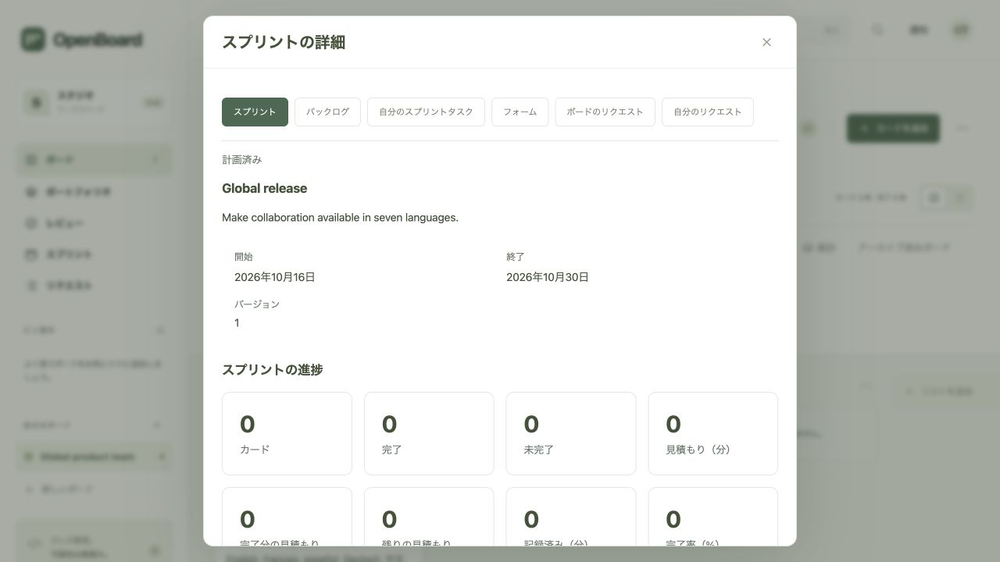
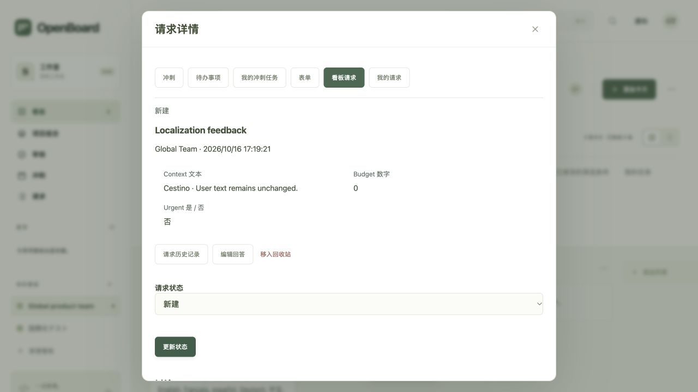

# Languages and translation maintenance

OpenBoard supports English (`en`), Italian (`it`), French (`fr`), Spanish (`es`), German (`de`), Simplified Chinese (`zh-CN`) and Japanese (`ja`). Translations are bundled with the static frontend; no translation service, external fonts, CDN or npm package is required at runtime.

## Choosing a language

The selector is available in the sign-in dialog and the workspace header. An explicit `?lang=` URL takes priority, followed by the browser preference saved under `openboard.language`, then the first supported browser language. Unsupported browser languages fall back to English. Regional variants map to their supported base language; Chinese variants use Simplified Chinese.

Changing language reloads the interface. Close an editor or panel first; switching is blocked while a save is pending or an editor is open. Draft storage remains scoped to the same account and resource. If the browser blocks local storage, the selector uses the `lang` URL parameter instead, preserving the board fragment and other query parameters.

Dates, accessible labels, feedback messages, standard catalogue labels and API errors are localized. Card summaries and selection counters use `Intl.PluralRules` and locale number formatting. Date inputs and API payloads retain ISO dates; booleans, numbers, identifiers, enum values, JSON and iCalendar protocols keep their original types and values.

Board titles, list names, descriptions, comments, usernames, custom field names, options and submitted answers are user content and remain unchanged when language changes. New boards send a `language` hint to `POST /api/boards`, which creates their three initial lists in that language. The API defaults to Italian when the hint is omitted, preserving compatibility. The interface also supplies localized copy suffixes when duplicating boards or saved reports, preserving the original name within the API character limit. Changing the interface language does not rename existing lists or translate demonstration data.

The C backend continues to expose authenticated APIs only. API error responses retain their canonical messages; the frontend translates them for display. API clients should use HTTP status codes rather than translated text. Unknown errors use a generic message in the selected language.

## Adding or editing translations

Italian authored text acts as the translation key. Each entry in `locales/*.json` contains six translations in this fixed order:

```json
{
  "Cestino": ["Trash", "Corbeille", "Papelera", "Papierkorb", "回收站", "ゴミ箱"]
}
```

Use `tr('Authored text')` for plain text and tagged `tr` templates for messages with dynamic values. Template expressions become positional placeholders such as `{0}` and `{1}`. Every translation must preserve the placeholders, though their order may change. `OpenBoardI18n.count(one, other, count, params)` selects the appropriate plural form and supplies the formatted `{count}` value.

Tag HTML templates with `ui`. The runtime translates authored text and accessible attributes **before** interpolating dynamic values. It never scans rendered user data. Continue escaping user text with the existing `escapeHTML`/`e` helpers: `ui` preserves interpolated HTML fragments and does not automatically escape them. Do not pass arbitrary user content to `tr`.

Generate the committed browser bundle after editing catalogues:

```sh
python3 scripts/build-locales.py
make test-frontend
```

The builder validates all six translations and placeholder parity. Shared keys follow a deterministic priority: common, core, planning, workflows, errors, extra errors, counts, then activity. Put deliberate shared-term overrides in `locales/common.json`.

The dependency-free extractor inspects static translation calls, nested templates, authored HTML and C API errors without evaluating interpolation expressions:

```sh
node scripts/extract-i18n.cjs web/app.js web/planning.js web/enterprise.js web/workflows.js web/productivity.js web/index.html
node scripts/extract-i18n.cjs src/*.c
```

The frontend test target checks that the generated bundle is current, that all extracted sources are covered, and that placeholders, HTML escaping, language detection, storage fallback, switching guards, date formatting and plural rules behave correctly. Labels selected dynamically from trusted API catalogues need explicit entries as well.

## Validation for this change

- 1,470 catalogue entries, each with six translations; Italian remains the source language.
- Source coverage: 1,116 UI messages and 318 static C API errors.
- Recorded combined Python suite: 176 checks passed and 13 optional checks skipped. The same checks passed with AddressSanitizer and UndefinedBehaviorSanitizer. See the [security audit](SECURITY_AUDIT_2026-10-16.md) for additional external-storage validation and remaining deployment risks.
- Both Docker images build; three isolated HTTP tests verify frontend assets, security headers and static access restrictions.
- All five JavaScript suites pass: localization runtime, source coverage, base frontend, enterprise panels and workflows.
- Browser checks on an isolated authenticated instance: all six new languages before and after sign-in; French authentication error; Japanese sprint dates and new-board lists; Chinese request submission preserving numeric zero and boolean false; unchanged user content across switches.
- Actual activity rendering verified with 12 events from authenticated C APIs in all seven languages, including escaped user content and localized fallbacks for unknown event codes.
- Desktop layout at 1280 pixels and mobile layout at 390 pixels checked in English, German, Chinese and Japanese, without horizontal page overflow.





