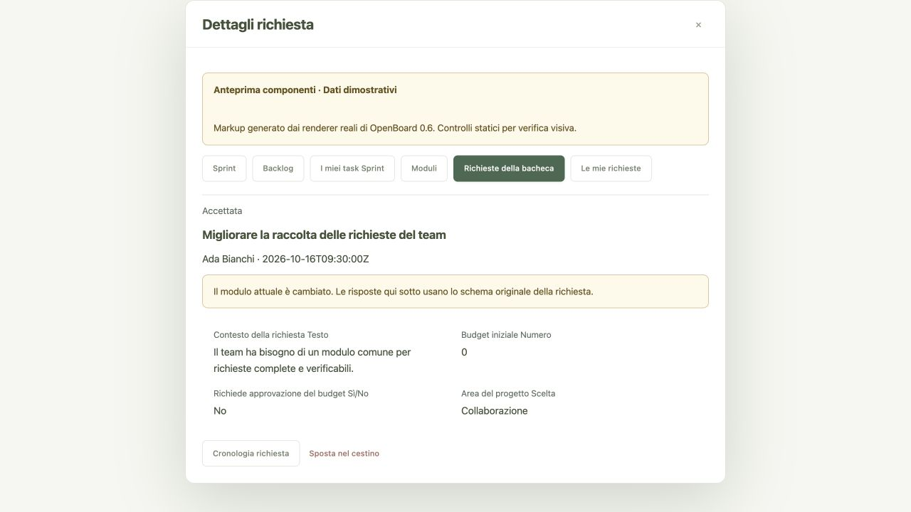

# Quinto gruppo di 100 migliorie di OpenBoard

OpenBoard 0.6 aggiunge sprint e moduli interni per raccogliere richieste strutturate. La numerazione continua da 401 a 500. Le funzioni API e le corrispondenti interazioni dell'interfaccia sono interventi separati, come nei gruppi precedenti. Le 100 voci sono implementate e coperte dalle verifiche riportate in fondo.

## Sprint e iterazioni: API

- [x] 401 Creazione di uno sprint con nome, obiettivo e intervallo di date.
- [x] 402 Elenco degli sprint della bacheca.
- [x] 403 Lettura dei dettagli e dei permessi di uno sprint.
- [x] 404 Modifica di nome, obiettivo e date dello sprint.
- [x] 405 Attivazione dello sprint con una sola iterazione attiva per bacheca.
- [x] 406 Chiusura dello sprint senza completare artificialmente le schede.
- [x] 407 Riapertura di uno sprint chiuso con controllo dei conflitti di pianificazione.
- [x] 408 Rimozione recuperabile di uno sprint.
- [x] 409 Ripristino di uno sprint dal cestino.
- [x] 410 Assegnazione di una scheda allo sprint.
- [x] 411 Rimozione di una scheda dallo sprint.
- [x] 412 Assegnazione multipla atomica di schede allo sprint.
- [x] 413 Rimozione multipla atomica di schede dallo sprint.
- [x] 414 Backlog delle schede non pianificate in sprint aperti.
- [x] 415 Ricerca e filtri paginati delle schede dello sprint.
- [x] 416 Impostazione della capacità di lavoro per persona.
- [x] 417 Confronto tra capacità e lavoro assegnato nello sprint.
- [x] 418 Registrazione esplicita dell'avanzamento della giornata UTC.
- [x] 419 Consultazione delle osservazioni giornaliere dello sprint.
- [x] 420 Rimozione di un'osservazione registrata per errore.
- [x] 421 Riepilogo di schede, stime e tempo effettivo dello sprint.
- [x] 422 Confronto tra impegno residuo e capacità disponibile.
- [x] 423 Elenco personale delle attività negli sprint attivi.
- [x] 424 Esportazione CSV del piano dello sprint.
- [x] 425 Cronologia paginata dei cambiamenti allo sprint.

## Moduli interni e richieste: API

- [x] 426 Creazione di un modulo con bacheca e lista di destinazione.
- [x] 427 Elenco dei moduli accessibili della bacheca.
- [x] 428 Lettura dello schema dinamico dei campi di un modulo.
- [x] 429 Modifica di nome, descrizione e destinazione del modulo.
- [x] 430 Pubblicazione e sospensione del modulo.
- [x] 431 Rimozione recuperabile di un modulo.
- [x] 432 Ripristino di un modulo.
- [x] 433 Aggiunta di campi testo, numero, data, booleano o scelta.
- [x] 434 Modifica di nome, obbligatorietà e opzioni dei campi.
- [x] 435 Riordino dei campi del modulo.
- [x] 436 Rimozione recuperabile di un campo del modulo.
- [x] 437 Ripristino di un campo rimosso.
- [x] 438 Invio autenticato di una richiesta con risposte tipizzate.
- [x] 439 Inbox delle richieste della bacheca.
- [x] 440 Elenco delle proprie richieste ancora accessibili.
- [x] 441 Lettura della richiesta con lo schema conservato al momento dell'invio.
- [x] 442 Valutazione della richiesta: nuova, in valutazione, accettata o respinta.
- [x] 443 Discussione collegata alla richiesta tramite note.
- [x] 444 Modifica delle proprie risposte prima dell'accettazione.
- [x] 445 Conversione atomica di una richiesta accettata in una scheda.
- [x] 446 Rimozione recuperabile di una richiesta.
- [x] 447 Ripristino di una richiesta rimossa.
- [x] 448 Cronologia paginata delle modifiche alla richiesta.
- [x] 449 Statistiche delle richieste della bacheca.
- [x] 450 Esportazione CSV delle richieste con protezione dalle formule.

## Sprint e iterazioni: interfaccia

- [x] 451 Composizione dello sprint con obiettivo e date.
- [x] 452 Consultazione degli sprint della bacheca.
- [x] 453 Apertura del dettaglio dello sprint e delle azioni consentite.
- [x] 454 Modifica dello sprint dall'interfaccia.
- [x] 455 Comando per attivare uno sprint.
- [x] 456 Comando per chiudere uno sprint.
- [x] 457 Comando per riaprire uno sprint chiuso.
- [x] 458 Consultazione del cestino degli sprint.
- [x] 459 Ripristino degli sprint dall'interfaccia.
- [x] 460 Assegnazione dell'attuale scheda a uno sprint dall'editor.
- [x] 461 Rimozione della singola scheda dallo sprint.
- [x] 462 Selezione e assegnazione multipla di schede dal backlog.
- [x] 463 Selezione e rimozione multipla di schede dallo sprint.
- [x] 464 Consultazione del backlog della bacheca.
- [x] 465 Ricerca, filtri e caricamento delle pagine delle schede dello sprint.
- [x] 466 Editor della capacità per persona.
- [x] 467 Visualizzazione del carico rispetto alla capacità dello sprint.
- [x] 468 Registrazione dell'avanzamento odierno dall'interfaccia.
- [x] 469 Visualizzazione delle osservazioni giornaliere realmente registrate.
- [x] 470 Correzione delle osservazioni tramite rimozione esplicita.
- [x] 471 Consultazione dell'avanzamento complessivo dello sprint.
- [x] 472 Lettura dell'impegno residuo rispetto alla capacità disponibile.
- [x] 473 Consultazione delle proprie attività negli sprint attivi.
- [x] 474 Download CSV del piano dello sprint.
- [x] 475 Consultazione paginata della cronologia dello sprint.

## Moduli interni e richieste: interfaccia

- [x] 476 Composizione di un modulo con scelta della lista di destinazione.
- [x] 477 Consultazione dei moduli della bacheca.
- [x] 478 Anteprima del modulo costruita dallo schema restituito dalle API.
- [x] 479 Modifica dei metadati e della destinazione del modulo.
- [x] 480 Comandi per pubblicare o sospendere un modulo.
- [x] 481 Consultazione del cestino dei moduli.
- [x] 482 Ripristino dei moduli dall'interfaccia.
- [x] 483 Creazione dei campi tipizzati del modulo.
- [x] 484 Modifica dei campi e delle opzioni di scelta.
- [x] 485 Riordino dei campi del modulo dall'interfaccia.
- [x] 486 Rimozione dei campi del modulo dall'interfaccia.
- [x] 487 Ripristino dei campi rimossi dall'interfaccia.
- [x] 488 Compilazione e invio delle richieste con controlli tipizzati.
- [x] 489 Consultazione dell'inbox delle richieste della bacheca.
- [x] 490 Consultazione delle proprie richieste.
- [x] 491 Lettura delle risposte con le definizioni originali dei campi.
- [x] 492 Valutazione della richiesta dall'interfaccia.
- [x] 493 Aggiunta e lettura delle note della richiesta.
- [x] 494 Modifica delle proprie risposte ancora modificabili.
- [x] 495 Conversione della richiesta accettata e navigazione alla scheda creata.
- [x] 496 Consultazione del cestino delle richieste.
- [x] 497 Ripristino delle richieste dall'interfaccia.
- [x] 498 Consultazione paginata della cronologia della richiesta.
- [x] 499 Consultazione delle statistiche delle richieste della bacheca.
- [x] 500 Download CSV delle richieste della bacheca.

## Perimetro e verifica

Il backend C continua a esporre soltanto API; frontend, PostgreSQL, MongoDB e proxy rimangono separati. I moduli sono interni e richiedono account e accesso corrente alla bacheca. Lo schema conservato insieme a una richiesta permette di leggere risposte precedenti anche dopo la modifica del modulo.

Lo schema 7 aggiunge tabelle, indici e trigger senza riscrivere i dati preesistenti. I dati strutturati degli sprint e delle richieste sono conservati in PostgreSQL; opzioni dei campi, risposte e schemi JSON sono documenti MongoDB. Il backup completo include entrambi. L'aggiornamento esterno supportato preserva i riferimenti JSON esistenti.

Le osservazioni dello sprint sono acquisite esplicitamente: l'app non inventa valori storici né promette una raccolta automatica a processo spento. Il confronto con la capacità è espresso in minuti e non costituisce una previsione certa della data di consegna.

### Risultati delle verifiche

| Verifica | Risultato |
| --- | --- |
| Suite Python completa (`make test`) | 168 casi, 155 superati e 13 opzionali eseguiti separatamente |
| AddressSanitizer e UndefinedBehaviorSanitizer (`make test-sanitize`) | 168 casi, stesso esito, nessun errore dei sanitizer |
| Persistenza PostgreSQL/MongoDB con driver nativi e container temporanei | 11 test superati, incluse migrazioni 5→7 e 6→7, rollback, indisponibilità MongoDB e due repliche |
| Frontend Nginx nell'immagine 0.6.0 | 3 test HTTP superati, risorse, header e percorsi non autorizzati |
| Frontend JavaScript (`make test-frontend`) | Tre suite superate: base, enterprise e workflow |
| Build Docker | Backend C e frontend statico 0.6.0 compilati |
| Configurazione e workflow | `docker compose config --quiet`, `actionlint` e `git diff --check` superati |

I 13 test dedicati agli sprint e i 14 dedicati ai moduli sono inclusi nella suite Python. Verificano sessioni reali, revoche immediate, concorrenza e versioni, quote, operazioni multiple atomiche, rollback, storico, formule nei CSV, Unicode e tipi JSON. Un test con 1000 note verifica che gli elenchi conservino soltanto il conteggio; dettaglio e endpoint dedicato restituiscono tutte le note.

Una fixture SQL generata dalla versione 0.5 verifica la migrazione locale 6→7 conservando account, approvazioni, discussione, filtri JSON e tempo registrato. I test con PostgreSQL/MongoDB verificano anche i riferimenti originali dei documenti, i booleani `false`, i numeri `0`, gli schemi storici, la conversione in scheda e le osservazioni sprint dopo ricostruzione della cache e backup completo.

Le suite JavaScript verificano rendering sicuro, filtri e paginazione, permessi restituiti dal backend, versioni, bozze separate per account e risorsa, risposte tardive, CSV e conferme HTML accessibili. Le conferme distruttive supportano Conferma, Annulla ed Escape e vengono invalidate al cambio di pannello o account. Un controllo del frontend contro API C reali ha esercitato il contratto dei due moduli.

Prova nel browser su istanza autenticata temporanea: creazione di uno sprint con obiettivo e date, selezione di tre schede dal backlog e assegnazione multipla, dettaglio aggiornato a tre schede e 195 minuti. Un vecchio popup nativo del browser integrato ha bloccato la successiva verifica manuale delle conferme; il codice ora usa conferme HTML e i relativi test di interazione passano. Il layout dei componenti generati dai renderer reali è stato verificato separatamente con dati dimostrativi dichiarati: viewport di 1280 e 390 pixel, nessun overflow orizzontale della pagina o dei pannelli. Le anteprime statiche non rappresentano una sessione live né sostituiscono i test delle API.

### Limiti espliciti

- I moduli sono interni: richiedono un account e accesso corrente alla bacheca.
- Le osservazioni giornaliere sono registrate su richiesta; non esiste un processo automatico di raccolta o una ricostruzione retroattiva.
- Capacità e impegno sono espressi in minuti. Le schede prive di stima sono segnalate; non viene promessa una data di consegna.
- L'associazione alla scheda convertita rimane storica anche dopo una rimozione definitiva; il frontend segnala quando la scheda non è più disponibile.
- I CSV hanno limiti espliciti di righe e dimensione e rifiutano esportazioni eccessive senza produrre risultati parziali.
- L'esportazione JSON della singola bacheca non sostituisce il backup completo: sprint, moduli, richieste e report personali richiedono il backup dell'istanza.
- L'archiviazione esterna conserva il limite già documentato: richieste serializzate e snapshot completo a ogni scrittura, adatti a installazioni pilota.

Le immagini sono state costruite e testate senza aggiornare i servizi dell'installazione locale già in esecuzione.
