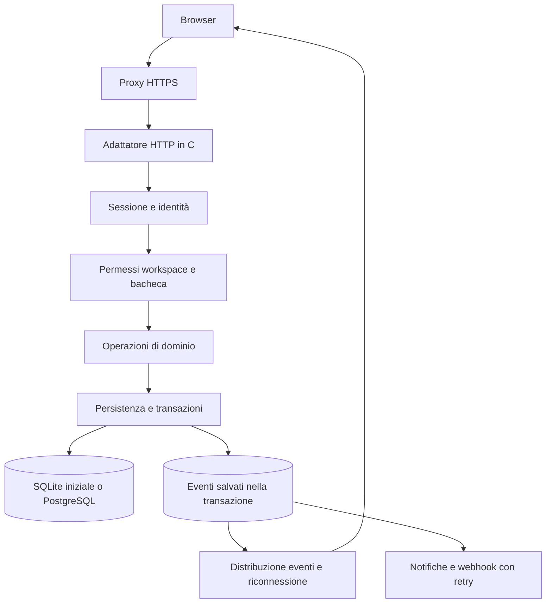

# Studio delle migliorie di OpenBoard per team e aziende

> **Historical archive (Italian).** This document records an earlier analysis or implementation checklist. Its setup examples, security assumptions and roadmap may be superseded. For current guidance, use the [documentation index](README.md), [deployment guide](DEPLOYMENT.md) and [changelog](../CHANGELOG.md).

Data: 15 ottobre 2026. Versione analizzata: [93493c5](https://github.com/GiorgioOppo/OpenBoard/commit/93493c5b74b8ad527e42691439233f457bf5990d).

OpenBoard dispone di una base kanban locale funzionante. Per diventare un'alternativa completa a Trello per team e aziende, il prossimo investimento deve rendere affidabili dati, identità e collaborazione. Aggiungere molte viste prima di queste fondamenta aumenterebbe il costo delle modifiche successive.

La direzione consigliata è mantenere il backend in C, iniziare da un'installazione aziendale su un singolo server e sviluppare una piattaforma modulare. SQLite può sostenere il primo pilota condiviso se le misure lo confermano; PostgreSQL diventa una scelta concreta quando servono più istanze applicative, maggiore concorrenza in scrittura o alta disponibilità. Il primo traguardo è un team che riesca a trasferire il lavoro da Trello e usarlo ogni giorno. La parità enterprise completa richiede fasi ulteriori.

## Stato attuale e qualità da conservare

Sono già presenti bacheche, colonne, schede, descrizioni, scadenze, checklist, preferiti, ricerca nella bacheca, filtri, vista elenco, trascinamento ed esportazione JSON. Il backend usa statement preparati, transazioni, foreign key e indici; valida tipi, UTF-8, date e dimensioni delle richieste. Il servizio ascolta su loopback, verifica Host/Origin e serve un elenco limitato di asset. Il frontend esegue escaping dei dati e protegge dai caricamenti fuori ordine. La licenza è MIT e l'interfaccia non richiede CDN.

I nove test di integrazione sono stati rieseguiti durante questo studio con un binario compilato dal sorgente e database temporanei: tutti superati. Verificano un insieme utile di comportamenti API, ma non dimostrano la correttezza del browser, la sicurezza multiutente o la capacità sotto carico. I test statici usano asset fittizi: [test API](https://github.com/GiorgioOppo/OpenBoard/blob/93493c5/tests/test_api.py#L27-L31).

L'assenza di account è coerente con l'attuale versione personale. Diventa un blocco rispetto al nuovo obiettivo aziendale; la protezione dell'origine HTTP non identifica una persona e non assegna permessi.

## Problemi concreti e ordine degli interventi

Le priorità indicano l'ordine di sviluppo: **P0** prima dell'uso condiviso, **P1** prima di un pilota affidabile, **P2** ampliamento successivo. Le condizioni future sono distinte dai difetti riprodotti nella versione locale.

| ID | Priorità | Evidenza ed effetto | Intervento e criterio di completamento |
| --- | --- | --- | --- |
| A1 | P0 | Schema globale senza utenti, appartenenze o ruoli. Gli assegnatari sono stringhe. [Schema](https://github.com/GiorgioOppo/OpenBoard/blob/93493c5/src/server.c#L451-L455) | Identità, workspace, membri e autorizzazioni centralizzate. Un utente estraneo non legge né modifica una risorsa attraverso alcun endpoint. |
| A2 | P0 | Due modifiche basate sulla stessa checklist vengono accettate con HTTP 200; la seconda può annullare la prima. L'editor reinvia tutti i campi. [Editor](https://github.com/GiorgioOppo/OpenBoard/blob/93493c5/web/app.js#L389-L392) | Revisione della risorsa, controllo atomico della versione e UI di conflitto che conserva la bozza. Nessuna sovrascrittura silenziosa nei test con due sessioni. |
| A3 | P0 | Il server gestisce una connessione alla volta. Una richiesta parziale mantenuta attiva ha bloccato una richiesta health per oltre 5,81 secondi. [Timeout](https://github.com/GiorgioOppo/OpenBoard/blob/93493c5/src/server.c#L591), [ciclo](https://github.com/GiorgioOppo/OpenBoard/blob/93493c5/src/server.c#L622-L625) | Trasporto concorrente con limiti di connessioni e tempo totale della richiesta. Una connessione lenta non deve fermare i client normali. |
| A4 | P1 | POST/PATCH riuscito seguito da GET fallita viene presentato come errore generico; il dialog è già chiuso e lo stato rimane vecchio. [Salvataggio](https://github.com/GiorgioOppo/OpenBoard/blob/93493c5/web/app.js#L392), [refresh](https://github.com/GiorgioOppo/OpenBoard/blob/93493c5/web/app.js#L220-L224) | Distinguere scrittura confermata, sincronizzazione fallita ed esito incerto. Identificatori idempotenti sulle creazioni; ritentare una richiesta non deve duplicare oggetti. |
| A5 | P1 | DELETE elimina definitivamente; le cancellazioni di bacheca/lista propagano alle schede. [Cancellazione](https://github.com/GiorgioOppo/OpenBoard/blob/93493c5/src/server.c#L359-L369) | Archivio, cestino e ripristino con permessi; purge separato e retention configurabile. Recuperare una lista con schede e checklist preservandone i riferimenti. |
| A6 | P1 | Schema creato con `CREATE TABLE IF NOT EXISTS`, senza sequenza di migrazioni applicative. [Inizializzazione](https://github.com/GiorgioOppo/OpenBoard/blob/93493c5/src/server.c#L445-L458) | Migrazioni versionate e transazionali, controllo della versione supportata, backup prima dell'upgrade e procedura di recupero provata. |
| A7 | P1 | Ogni refresh serializza tutte le descrizioni e checklist di tutte le schede. [Query](https://github.com/GiorgioOppo/OpenBoard/blob/93493c5/src/server.c#L233-L238) | Risposte riassuntive, dettagli su richiesta, paginazione per lista e aggiornamenti mirati. Nessun download completo dopo un semplice cambio di etichetta. |
| A8 | P1 | Descrizioni e altri testi hanno contrasto insufficiente; il toggle checklist ricrea il controllo focalizzato. [Colori](https://github.com/GiorgioOppo/OpenBoard/blob/93493c5/web/styles.css#L1244-L1254), [toggle](https://github.com/GiorgioOppo/OpenBoard/blob/93493c5/web/app.js#L379) | Palette accessibile, focus stabile, dialog nominati e spostamento/riordino utilizzabili da tastiera. Verifica automatica e manuale. |
| A9 | P1 | Host ammessi e schema Origin sono fissati a localhost e HTTP. Un hostname esterno, o un Origin HTTPS dietro proxy, viene rifiutato. [Host](https://github.com/GiorgioOppo/OpenBoard/blob/93493c5/src/server.c#L504-L506), [Origin](https://github.com/GiorgioOppo/OpenBoard/blob/93493c5/src/server.c#L384-L385) | URL pubblico configurato, HTTPS al proxy, origini ammesse e proxy fidati espliciti. Superare test con il vero hostname senza disattivare i controlli. |
| A10 | P2 | Creare una bacheca con `starred:true` restituisce successo ma salva `false`: il campo viene validato e omesso nell'INSERT. [Creazione](https://github.com/GiorgioOppo/OpenBoard/blob/93493c5/src/server.c#L251-L260) | Chiarire il contratto e correggere il roundtrip. Nel modello multiutente i preferiti devono diventare personali. |
| A11 | P1 | Alcuni errori SQL terminano il processo; una lettura fallita può essere trattata come risorsa assente. Health non verifica lo storage. [Helper SQL](https://github.com/GiorgioOppo/OpenBoard/blob/93493c5/src/server.c#L63-L75), [health](https://github.com/GiorgioOppo/OpenBoard/blob/93493c5/src/server.c#L391) | Errori tipizzati, rollback, risposta temporanea quando appropriata e readiness separata. Provare lock, disco pieno e storage indisponibile senza inventare un crash remoto non dimostrato. |

A2 e A3 sono stati riprodotti su dati temporanei. Per A3 sono stati inviati piccoli frammenti ogni 1,6 secondi: il timeout corrente vale per singola lettura, quindi non impone una scadenza totale. La richiesta health è ripartita dopo la chiusura del client incompleto. Il problema è già rilevante in locale con più connessioni; l'esposizione a una rete aumenterebbe l'impatto.

A4 deriva dal flusso del codice e richiede un test browser con errori di rete iniettati. Un timeout o una risposta persa non dimostra che la scrittura sia fallita: la UI deve poter verificare l'esito senza invitare a creare una seconda scheda.

## Misure sulle bacheche grandi

È stata misurata la risposta GET della bacheca su macOS arm64, in loopback, con il binario corrente. Il database temporaneo conteneva schede sintetiche con descrizione di 1.000 caratteri e tre voci di checklist. Ogni taglia è stata letta cinque volte; i tempi comprendono il trasferimento al client locale, non il rendering nel browser né il carico concorrente.

| Schede | Byte della risposta | Mediana GET | Massimo dei cinque campioni |
| ---: | ---: | ---: | ---: |
| 100 | 140.276 | 0,94 ms | 1,44 ms |
| 1.000 | 1.402.087 | 7,11 ms | 9,12 ms |
| 5.000 | 7.022.087 | 35,66 ms | 41,00 ms |

La serializzazione locale è rapida in questa prova, ma il volume cresce con tutto il contenuto della bacheca. Trasferire circa 7 MB dopo ogni azione costa banda e lavoro al browser. Con una connessione ipotetica da 10 Mbit/s, il solo volume equivale a circa 5,6 secondi teorici, prima di latenza e altri costi: non è una misura del comportamento reale dell'app su quella rete.

Il frontend ha un ulteriore costo evitabile: ogni avatar ricostruisce la lista degli assegnatari scandendo le schede, e ricerca/filtri ricreano l'intero DOM. [Assegnatari](https://github.com/GiorgioOppo/OpenBoard/blob/93493c5/web/app.js#L99-L104). Calcolare gli indici una volta per snapshot e aggiornare solo i nodi cambiati è un primo intervento economico. Virtualizzazione e ranking avanzato dell'ordine vanno introdotti dopo misure browser e profili delle bacheche reali.

Il riordino attuale aggiorna posizioni di molte schede in una transazione. È corretto per una lista piccola; prima di sostituirlo con posizioni spaziate occorre misurare contesa e durata delle transazioni. L'obiettivo iniziale è evitare download e rendering completi, non complicare subito l'algoritmo di ordinamento.

## Architettura proposta mantenendo C

Separare trasporto HTTP, identità, autorizzazioni, dominio e persistenza. I controlli di accesso devono proteggere anche esportazioni, ricerca, allegati ed eventi realtime. La scelta di una libreria HTTP non trasferisce a quella libreria le regole di sicurezza del prodotto.

Una possibile divisione è `http/`, `api/`, `auth/`, `domain/`, `storage/`, `events/` e `jobs/`, con `main.c` limitato all'avvio. Il frontend può restare JavaScript senza framework, separando API, stato, routing, editor e rendering. Una riscrittura con un framework va motivata da manutenzione e complessità osservate.

**Trasporto.** Valutare una libreria C mantenuta, con timeout, limiti, gestione della concorrenza, test e politica di sicurezza. CivetWeb è un candidato: documenta embedding in C, licenza MIT, HTTPS e WebSocket. Serve una prova tecnica su parser, connessioni lente, arresto e modello dei worker prima dell'adozione. [CivetWeb ufficiale](https://github.com/civetweb/civetweb).

**Database.** SQLite consente un solo writer alla volta; WAL consente la coesistenza di lettori e scrittore, ma richiede lo stesso host. Non scegliere PostgreSQL solo dal numero di account registrati: misurare scritture simultanee, attesa dei lock, latenza e requisiti di disponibilità. [Scelta del database](https://www.sqlite.org/whentouse.html), [WAL](https://www.sqlite.org/wal.html).

Con worker concorrenti non riutilizzare senza sincronizzazione l'attuale connessione SQLite globale: definire connessioni possedute dai worker o una coda di scrittura e rispettare il modello di threading della libreria. Per i deployment riproducibili fissare una versione e verificare la libreria realmente linkata. La documentazione WAL corrente segnala un raro bug corretto in 3.51.3 e nei backport 3.44.6/3.50.7; riguarda connessioni concorrenti in scrittura/checkpoint e non prova un difetto dell'attuale istanza a connessione singola. Il binario verificato in questo ambiente è collegato a SQLite 3.54.0. [Threading SQLite](https://www.sqlite.org/threadsafe.html), [nota WAL](https://www.sqlite.org/wal.html).

Le verifiche di esistenza, appartenenza e conteggio delle posizioni attualmente precedono l'apertura della transazione di scrittura. Quando si introduce elaborazione parallela, queste verifiche e l'aggiornamento devono rientrare nella stessa transazione, insieme al controllo della revisione: aggiungere worker senza questa modifica introdurrebbe finestre di concorrenza nel dominio.

**Conflitti.** Aggiungere `version`, `created_at`, `updated_at`, autore e ultima modifica alle risorse. Il comando verifica e incrementa la versione nella stessa transazione. Per l'API HTTP, ETag e `If-Match` consentono di rifiutare una revisione obsoleta con 412; un conflitto di dominio distinto può usare 409. Non ritentare automaticamente sovrascrivendo il dato corrente. [RFC 9110](https://www.rfc-editor.org/rfc/rfc9110.html#section-13.1.1).

**Eventi.** Salvare modifica ed evento nella stessa transazione, poi distribuire gli eventi dopo il commit. Per il primo realtime, REST per i comandi e SSE per gli aggiornamenti sono una proposta semplice da valutare; WebSocket diventa utile per interazioni bidirezionali più ricche. Occorrono cursore di ripresa, rilevamento dei buchi, risincronizzazione e revoca dei permessi sulle connessioni aperte. Il realtime non risolve i conflitti di scrittura. [Standard SSE](https://html.spec.whatwg.org/multipage/server-sent-events.html).

## Modello dei dati per il prodotto condiviso

| Area | Entità proposte | Decisione necessaria |
| --- | --- | --- |
| Identità | utenti, identità esterne, sessioni | Account disattivati, revoca, recupero e amministratore iniziale |
| Organizzazione | workspace, membri, inviti, membri bacheca | Ruoli di workspace separati da permessi delle bacheche |
| Lavoro | bacheche, liste, schede, assegnazioni, etichette | Assegnatari tramite ID, etichette multiple configurabili |
| Collaborazione | commenti, menzioni, sottoscrizioni, notifiche | Autore, modifiche, privacy e preferenze di consegna |
| Cronologia | attività, revisioni, eventi, richieste idempotenti | Conservazione, conflitti, deduplicazione e audit |
| Recupero | stato archiviato, cestino, riferimenti ai file | Ripristino coerente di una gerarchia e purge controllato |
| Allegati | metadati, oggetti, quote | Accesso autorizzato e backup coerente con il database |

Separare le voci di checklist diventa utile quando si vogliono modifiche concorrenti, assegnatari e scadenze per singola attività. I preferiti appartengono all'utente; una bacheca evidenziata per tutti è una proprietà diversa.

Definire esplicitamente la relazione fra lista, flag completata e checklist: oggi sono indipendenti. Le regole automatiche devono essere configurabili, non dipendere dal testo italiano del nome di una colonna. Per report sul flusso servono eventi e tempi di attraversamento, non solo la posizione attuale.

L'installazione singola per azienda è il primo obiettivo operativo consigliato. Il SaaS con più clienti nella stessa infrastruttura richiede un progetto specifico di isolamento, gestione dei tenant, quote e disponibilità; non va ottenuto aggiungendo soltanto un campo a una query.

## Identità e autorizzazioni aziendali

Introdurre almeno amministratore del workspace, membro e osservatore; aggiungere guest con accesso limitato a bacheche selezionate quando i flussi base sono stabili. Applicare il rifiuto predefinito e verificare ogni richiesta, compresi oggetti raggiunti tramite ID e relazioni tra scheda, lista e bacheca. [OWASP Authorization](https://cheatsheetseries.owasp.org/cheatsheets/Authorization_Cheat_Sheet.html).

Per login locale usare una libreria di alto livello per le password: `crypto_pwhash_*` di libsodium usa attualmente Argon2id. Misurare memoria, costo e numero di login concorrenti; introdurre limiti e protezioni anti-abuso. Non implementare internamente algoritmi crittografici. [Libsodium](https://libsodium.gitbook.io/doc/password_hashing).

Sessioni revocabili, cookie `Secure`, `HttpOnly` e `SameSite`, protezione CSRF, scadenze e rotazione devono accompagnare il login. OIDC permette l'integrazione con un identity provider aziendale e può delegare MFA; l'app deve comunque applicare i propri permessi. Un proxy di autenticazione richiede un confine fidato esplicito e deve rimuovere gli header identità forniti dal client. [Sessioni OWASP](https://cheatsheetseries.owasp.org/cheatsheets/Session_Management_Cheat_Sheet.html), [OpenID Connect](https://openid.net/specs/openid-connect-core-1_0.html).

SAML nativo, SCIM, policy avanzate e alta disponibilità vanno pianificati con clienti pilota. Non presentare una funzionalità come certificazione o conformità normativa: audit tecnico, requisiti organizzativi e verifiche indipendenti hanno ambiti distinti.

## Funzioni da aggiungere per sostituire Trello

| Sequenza | Capacità | Perché conta |
| --- | --- | --- |
| Prima | Link diretti a schede/bacheche, archivio, cestino, bozze, conflitti leggibili | Fiducia nei dati e possibilità di condividere il lavoro |
| Team | Membri reali, commenti, menzioni, attività, osservatori, notifiche e allegati | Coordinamento quotidiano senza ricorrere a canali separati |
| Adozione | Import Trello, export OpenBoard ripristinabile, ricerca globale autorizzata, Le mie attività | Trasferimento dei progetti e uso trasversale alle bacheche |
| Produttività | Etichette multiple, campi tipizzati, template, copia, azioni multiple, WIP, checklist avanzate | Adattamento a workflow reali senza personalizzazioni del codice |
| Pianificazione | Calendario, tabella, filtri salvati, dashboard e automazioni essenziali | Organizzazione e controllo del flusso |
| Azienda | OIDC, gruppi, audit esportabile, retention, policy inviti/file, API e webhook | Gestione operativa e integrazione con l'organizzazione |
| Successivamente | Timeline complessa, automazioni estese, plugin e assistenza AI | Valore da validare dopo stabilità e adozione |

Le automazioni richiedono permessi propri, limiti, log e prevenzione dei cicli. I webhook richiedono firma, retry e deduplicazione. Per gli allegati servono quote, controlli sui file, download autorizzati e una strategia di conservazione: il supporto non si esaurisce nell'aggiunta di un campo upload.

### Migrazione da Trello e portabilità

Il formato OpenBoard deve includere una versione dello schema e supportare un roundtrip verificato: esportazione, importazione su istanza nuova e confronto dei dati. Prevedere anteprima, mapping degli utenti, conteggi, anomalie, allegati e import ripetibile senza duplicazioni.

Trello documenta che il JSON della singola bacheca comprende le 1.000 azioni più recenti, inclusi commenti; il CSV non contiene i commenti. Per tutti i commenti indica l'export workspace Premium; gli allegati sono link se non vengono inclusi i file grezzi nello ZIP. Quindi l'importatore deve comunicare le omissioni invece di promettere un trasferimento integrale da qualunque JSON. [Export ufficiale Trello](https://support.atlassian.com/trello/docs/exporting-data-from-trello/).

Preferire un archivio caricato e controllato a scaricamenti automatici da URL arbitrari. Un importatore remoto deve difendersi anche dalle richieste verso servizi interni, con limiti e controlli sulle destinazioni. [OWASP SSRF](https://cheatsheetseries.owasp.org/cheatsheets/Server_Side_Request_Forgery_Prevention_Cheat_Sheet.html).

## Interfaccia e accessibilità

La palette e la struttura visiva possono essere conservate, aumentando contrasto e leggibilità. Calcoli sui colori CSS attuali:

| Testo | Colore e sfondo | Rapporto |
| --- | --- | ---: |
| Descrizione scheda | `#a0a995` su bianco | 2,44:1 |
| Descrizione bacheca | `#929b89` su `#fcfcf9` | 2,81:1 |
| Titolo scheda | `#43513a` su bianco | 8,48:1 |
| Titolo scheda completata | `#8e9c80` su bianco | 2,91:1 |

Il riferimento WCAG AA per il testo normale è 4,5:1. Questi calcoli identificano problemi specifici; non costituiscono una valutazione completa di conformità. [W3C Contrast Minimum](https://www.w3.org/WAI/WCAG22/Understanding/contrast-minimum.html).

Interventi iniziali: testo principale più leggibile, token semantici dei colori, dialog con nome accessibile, focus conservato durante checklist e salvataggi, controllo Apri separato dal completamento, stato dirty e bozza recuperabile. Aggiungere un comando Sposta che consenta anche la posizione nella lista, oltre alla colonna. La versione attuale consente lo spostamento da editor ma non il riordino completo da tastiera.

I controlli piccoli da 19–23 px richiedono verifica delle distanze e delle alternative. WCAG 2.2 indica 24×24 px con eccezioni; per i controlli touch principali è consigliabile progettare aree intorno a 44 px. [W3C Target Size](https://www.w3.org/WAI/WCAG22/Understanding/target-size-minimum.html).

Un controllo mobile da riprodurre nei test: la vista elenco ha minimo 600 px, mentre le colonne e i padding possono richiedere almeno 624 px a viewport piccoli; `overflow:hidden` può tagliare il bordo destro. Verificare il risultato su 320/390/768 px e zoom 200/400%, con contenuti lunghi. Non limitare la verifica a uno screenshot della bacheca.

## Esercizio e qualità del progetto open source

L'istruzione attuale di arrestare il server e copiare il database è corretta per il caso personale. Per un servizio aziendale servono backup online consistenti, conservazione e prove di restore. SQLite offre Online Backup API e `VACUUM INTO`; quando esistono allegati, database e file devono poter essere ripristinati in modo coerente. [Backup SQLite](https://www.sqlite.org/backup.html).

Preparare un'immagine container non privilegiata, volumi persistenti, configurazione documentata, avvio con proxy HTTPS e procedura di upgrade. Per ogni release pubblicare binari o immagini verificabili, changelog, versione delle dipendenze e procedura di recupero. L'hosting corrente non deve essere esposto semplicemente cambiando l'indirizzo di bind.

Aggiungere log strutturati con request ID, metriche di latenza/errori/code/lock, readiness e verifica storage, senza salvare password, token o contenuti sensibili nei log. Separare log operativo, attività di progetto e audit amministrativo.

La CI attuale compila ed esegue test API su Linux/macOS. Estenderla con controlli C, sanitizer, analisi statica, fuzzing del parser e dei comandi, test di migrazione e browser. Dipendenze fissate, scansione delle vulnerabilità e una policy `SECURITY.md` sono particolarmente utili quando il software gestisce dati aziendali. La documentazione deve descrivere limiti e modalità supportate per ogni release.

## Confronto con i riferimenti di mercato

Il confronto riguarda capacità documentate e licenze consultate il 15 ottobre 2026, non prestazioni misurate sui concorrenti.

| Prodotto | Evidenza rilevante | Conseguenza per OpenBoard |
| --- | --- | --- |
| Trello | I piani superiori aggiungono campi/checklist avanzati, viste, controllo amministrativo e funzioni enterprise. [Piani ufficiali](https://support.atlassian.com/trello/docs/which-trello-plan-is-best-for-me/) | L'obiettivo completo comprende governance e integrazione, oltre al kanban. |
| WeKan | MIT; documenta realtime, template, import Trello, regole, notifiche e ricerca. [Repository ufficiale](https://github.com/wekan/wekan/blob/main/README.md) | Il valore distintivo deve essere verificabile: operatività semplice, portabilità e UX affidabile. |
| Kanboard | MIT, workflow con WIP/azioni automatiche e integrazioni; il repository dichiara maintenance mode. [Sito](https://kanboard.org/), [repository](https://github.com/kanboard/kanboard) | Semplicità e mantenibilità sono un riferimento; maintenance mode non significa assenza di correzioni. |
| PLANKA | Documenta collaborazione e funzioni avanzate; la licenza attuale è Fair Use con offerte Pro/Enterprise. La guida dice che non soddisfa la definizione OSI. [Repository](https://github.com/plankanban/planka), [guida licenza](https://github.com/plankanban/planka/blob/master/LICENSES/PLANKA%20License%20Guide%20EN.md) | È un riferimento UX, ma non va presentata oggi come software MIT. Mantenere chiari licenza di OpenBoard e termini delle dipendenze. |

Il posizionamento proposto è un kanban aziendale self-hosted con controllo dei dati, migrazione trasparente, permessi comprensibili e amministrazione semplice. Il linguaggio C può aiutare una distribuzione compatta; il vantaggio va dimostrato misurando installazione, consumo, aggiornamento e affidabilità.

## Roadmap con criteri di uscita

Le stime sono intervalli di pianificazione, non preventivi. I giorni sono giorni-persona di sviluppo comprensivi dei test della capacità; integrazione, review indipendenti e feedback dei piloti possono aggiungere lavoro. Le voci condividono dipendenze e non vanno sommate come attività completamente parallele.

| Fase | Lavoro | Ordine di grandezza | Criterio di uscita |
| --- | --- | --- | --- |
| 0 Fondamenta | Modularizzazione C, trasporto concorrente, revisione/conflitti, esiti di scrittura, migrazioni, archivio/restore, CI browser | 25–45 giorni-persona | Test con connessioni lente, due tab, rete interrotta, upgrade e restore superati |
| 1 Team pilota | Account/sessioni, workspace/ruoli, inviti, membri reali, URL diretti, eventi/realtime, commenti e attività | 40–70 giorni-persona | Team indipendenti collaborano; revoche e permessi funzionano su API, export ed eventi |
| 2 Sostituzione operativa | Allegati, notifiche, import Trello/export roundtrip, ricerca globale, etichette/campi/template, accessibilità e deploy | 45–80 giorni-persona | Un progetto reale viene migrato con report delle omissioni e usato senza ritorno obbligato a Trello |
| 3 Azienda e ampliamento | OIDC/gruppi, audit/retention, integrazioni, automazioni, viste e eventuale PostgreSQL/HA | 60–120+ giorni-persona | Requisiti dei clienti selezionati verificati e gestione operativa documentata |

Con due sviluppatori esperti e supporto periodico di UX, QA e gestione operativa, un obiettivo iniziale plausibile è un pilota team in 2–4 mesi, al termine della fase 1 e con ambito limitato. La sostituzione operativa con migrazione, allegati e notifiche richiede anche la fase 2. Una versione aziendale ampia può richiedere 6–12 mesi o più. Sono ipotesi da rivedere dopo la fase 0. La parità con un prodotto enterprise maturo, l'alta disponibilità e un ampio ecosistema di integrazioni possono estendere significativamente questo orizzonte.

### Prima sequenza di implementazione

1. Documentare invarianti del dominio, contratto API, strategia migrazioni e modello delle autorizzazioni.
2. Isolare dominio/storage e provare l'adattatore HTTP concorrente con connessioni lente e connessioni DB correttamente possedute.
3. Introdurre revisioni e conflitti, distinguere salvataggio e refresh, aggiungere idempotenza e preservare bozze.
4. Aggiungere archivio/cestino, migrazioni e restore verificato prima di accumulare dati aziendali.
5. Implementare account, workspace, permessi e inviti con test di isolamento; poi eventi e collaborazione.

## Piano di verifica e metriche

I criteri seguenti sono obiettivi proposti da tarare sui piloti, non capacità già dimostrate.

| Area | Verifica obbligatoria | Indicatore |
| --- | --- | --- |
| Concorrenza | Due utenti modificano stesso campo, campi diversi, checklist e posizione | Zero sovrascritture silenziose; conflitti spiegati |
| Rete | Risposta POST persa dopo commit, PATCH riuscita/GET fallita, riconnessione | Zero duplicazioni da retry della stessa operazione; bozza preservata |
| Accesso | Ruoli e revoche su ogni endpoint, ricerca, file, export ed eventi aperti | Nessuna risorsa estranea leggibile/modificabile nei test |
| Recupero | Cestino, restore gerarchico, backup, upgrade e ripristino | Restore provato; RPO/RTO definiti con il cliente |
| Browser | CRUD, riordino primo/ultimo/intermedio, filtri, errori JS, storia URL | Suite con asset reali su Chromium/Firefox/WebKit |
| Accessibilità | Tastiera, focus, lettore schermo, contrasto, touch e zoom | Obiettivo WCAG 2.2 AA con verifica manuale delle attività principali |
| Prestazioni | Bacheche realistiche da 100/1.000/5.000 schede e carico misto | p95 letture/scritture, byte trasferiti, memoria, lock e ritardo eventi |
| Adozione | Tre team pilota importano, invitano, collaborano, revocano un guest e ripristinano una scheda | Successo dei compiti e supporto necessario |

Per il primo carico condiviso proporre scenari da 10, 25 e 50 utenti attivi simulati, distinguendo connessioni aperte da operazioni al secondo. Su hardware dichiarato, un possibile budget iniziale è p95 API sotto 300 ms per le operazioni ordinarie e visibilità degli eventi entro un secondo in condizioni normali. Misurare prima di trasformarli in promesse di servizio.

La scelta della prossima milestone è **OpenBoard affidabile per un team**, con gestione dei conflitti, identità, recuperabilità e deploy ripetibile. Questa milestone crea il modello su cui costruire l'alternativa completa richiesta.
