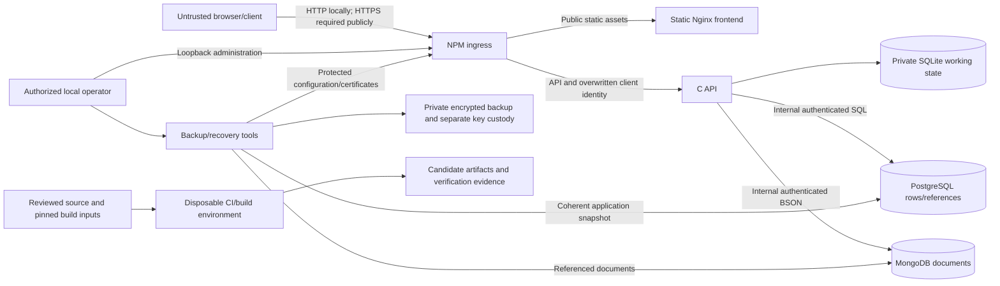

# Threat model

Reviewed on **18 October 2026**, starting from `b103d97caa38806a035d94d9a1af19bd4699ca6e` and the accompanying development changes. This is a maintained design review for the supplied self-hosted stack, not an independent penetration test or a production approval. The dated [audit](SECURITY_AUDIT_2026-10-16.md) and [remediation report](SECURITY_REMEDIATION_2026-10-16.md) remain historical evidence; their findings and image measurements must not be silently treated as current scans.

The [ASVS traceability guide](SECURITY_REQUIREMENTS.md) and [machine-readable inventory](security-requirements.json) record supporting paths, named regression tests and unresolved verification work. A named test is evidence of its stated scenario, not proof of the complete security property.

## Scope, assets and security objectives

The scope includes the C HTTP API, browser application, local development frontend, SQLite local mode, PostgreSQL/MongoDB external mode, the supplied static Nginx and Nginx Proxy Manager (NPM) images, bootstrap/preflight, backup/recovery tools and GitHub Actions. NPM's upstream administration application is a separate authentication system. Its private binding and our limiter do not constitute an audit of its entire codebase or token implementation.

| Asset | Required protection | Authority |
| --- | --- | --- |
| Accounts, salted password hashes, sessions and CSRF values | Confidentiality, unpredictable credentials, revocation and current authorization | C authentication service |
| Boards, cards, comments, requests, approvals, reports, attachments and deleted history | Authorized reads/writes; preserve ownership, ancestry and type constraints | Backend transactions and board ACL |
| PostgreSQL rows and referenced MongoDB documents | One consistent acknowledged application state | External-store publication protocol |
| SQLite database or reconstructed cache, WAL and temporary files | Private access, integrity, bounded capacity; distinguish authority from cache | Host/container operator |
| Browser DOM, account-scoped drafts and downloaded exports | Avoid executable content and cross-account response delivery | Frontend, browser and browser-profile owner |
| Database credentials, bootstrap credentials, backup decryption keys, TLS keys and NPM configuration | Keep private; prevent source/log exposure; protect recovery availability | Deployment operator |
| Source, action pins, build inputs, binary/image identities and verification evidence | Reviewable provenance and trusted release publication | Repository maintainer and GitHub owner |

OpenBoard is one installation with global administrators and board permissions. An instance administrator can access every board. Boards are **not SaaS tenants**: there are no workspace tenant boundaries, tenant-specific database credentials or guarantees against an instance administrator. Do not host mutually untrusted organizations under an assumed tenant-isolation contract.

## Data flows and trust boundaries

1. **Browser to origin:** requests, URL/query/body values, headers, imports, filenames and rich text are hostile even after frontend validation. A cookie authenticates a request; it does not authorize a board or prevent CSRF by itself. The frontend has no database credentials. Public health/readiness/version/setup-state responses are intentionally not equivalent to authenticated domain data.
2. **Client to proxy to API:** NPM terminates public TLS and routes `/api` to the backend. API version aliases must reach the same authorization, idempotency and rate-limit controls. Only the configured exact proxy IPv4 peer can assert one numeric `X-Real-IP`; no arbitrary forwarded chain or implicit CDN trust is accepted. A compromised trusted proxy can impersonate client addresses and observe traffic.
3. **API to storage:** backend handlers are the security authority. SQLite prepared statements and typed JSON validation precede persistence. MongoDB stores literal data, including supported dollar-prefixed keys, rather than interpreting user JSON as query operators. Database accounts are application-scoped, but their compromise exposes the installation dataset.
4. **Two persistent stores:** external operations take the PostgreSQL coordination lock. Immutable content-addressed documents are verified/written before SQL references and the revision commit. Failed publication returns an error and invalidates the working cache. This is a publication protocol, not a distributed transaction or high-availability guarantee. Unreferenced documents may remain. A copied live SQLite cache is not a complete external backup.
5. **Host and container:** only NPM host ports are published; ingress defaults to loopback, administration remains loopback, and databases use an internal network. The app/frontend are unprivileged with read-only roots and temporary writable storage. Container networking provides isolation, **not encryption**: the supplied internal HTTP/database connections do not configure TLS. A host/Docker administrator remains able to read memory, secrets and volumes.
6. **Operations and build:** bootstrap, restore and image builds have more privileges than ordinary users. Backup decryption and archive extraction cross an untrusted-file boundary. CI receives repository code and downloads build inputs; candidate artifacts are not promoted merely because unit tests passed. Live credentials and existing deployment volumes are outside test scope.

## Adversaries and assumptions

Consider anonymous remote clients, credential-stuffing clients, a malicious board member/observer, a revoked administrator or session, compromised client JavaScript/browser extensions, a reader of leaked backups/logs, a compromised dependency/build input, and a caller racing other users. Test and release evidence must also account for ordinary network outages, full disks, process interruptions and lost HTTP responses.

The deployment operator controls the host, Docker access, firewall, real DNS/TLS origin and private credential files. The repository maintainer controls reviewed source and release decisions. Neither a hostile host administrator nor a fully compromised trusted ingress can be contained by board ACLs. A same-profile browser user can read retained local drafts. These assumptions require an operator decision before using sensitive team data; they are not claims that these risks have been mitigated.

## Threat register

Priority means the next review priority for this deployment model, not a CVSS score or a claim of a discovered exploitable defect. **P1** affects sensitive data or publication prerequisites; **P2** is bounded hardening or resilience work. “Maintainer” owns code/release work; “operator” owns a particular running installation.

| ID / priority | Abuse or failure scenario | Existing mitigation and concrete evidence | Residual risk, owner and next action |
| --- | --- | --- | --- |
| TM-01 / P1 | An Internet visitor claims the first administrator, or discovers a shared default password. | No seeded application account. Bootstrap creates the application administrator before publishing its proxy host; local origin restrictions and the preflight inspect setup. `tests/test_security_deployment.py::test_readiness_requires_both_admins_and_authenticated_api_routing`; `tests/test_bootstrap_local.py`. | First-account setup remains an unauthenticated bootstrap capability. **Operator:** initialize both administrators privately and verify the running preflight before opening ingress. Generated bootstrap passwords have no enforced first-use rotation. |
| TM-02 / P1 | Guessing or distributed credential stuffing consumes password-hashing CPU or takes accounts. | PBKDF2-HMAC-SHA256 with random salts, generic bad-credential responses, fixed-memory monotonic backend quotas, per-client nginx limits and separate NPM limiter. `tests/test_auth_rate_limits.py`; `tests/test_transport.py::test_proxy_login_quotas_do_not_block_other_clients_or_accounts`; `tests/test_npm_limits.mjs`. | Counters are process-local; window boundaries permit adjacent budgets, collisions may reject early, and distributed attackers bypass per-IP controls. No application MFA or common-password blocklist. **Maintainer:** IDs 29/30/35; **operator:** capacity/perimeter monitoring. |
| TM-03 / P1 | Session theft, fixation, delayed revocation or an administrative operation through a stolen authenticated session. | Random 256-bit reference tokens stored as hashes, HttpOnly/SameSite Strict, Secure for configured HTTPS, idle/absolute expiry, logout/deactivation and transactional rechecks. `tests/test_auth.py::test_session_idle_absolute_expiry_and_duplicate_cookie`, `test_revoked_admin_cannot_create_users_after_waiting_for_a_writer`. | Cookie lacks a `__Host-`/`__Secure-` prefix; login does not revoke every previous session, and password change retains the current token. Administrative reauthentication is absent. **Maintainer:** review rotation/prefix migration and ID 34; **operator:** enforce HTTPS and protect profiles. |
| TM-04 / P1 | Cross-origin requests mutate data, Host confusion or forged proxy headers select another client's quota. | Exact public Host/Origin checks, authenticated write CSRF tokens, duplicate security-header rejection, exact trusted proxy and overwritten IP headers. `tests/test_auth.py::test_anonymous_and_csrf_and_cross_origin_protection`; `tests/test_transport.py::test_trusted_proxy_accepts_only_one_numeric_client_address`; proxy regressions. | An added upstream proxy/CDN changes this boundary. There is no blanket private-network trust. **Operator:** review and test the complete trust chain; keep the NPM console private. |
| TM-05 / P1 | A member/observer reads or changes another board, deleted ancestor or personal resource; a revoked user replays a successful cached response. | Current role/ACL, live ancestry, ownership and action gates precede domain operations and idempotency replay; protected writes recheck in the writer transaction. `tests/test_security_domain.py` covers revocation, personal ownership, review eligibility and restored ancestry. | Every new route, alias and replay family needs equivalent checks; board permission is not tenant isolation. **Maintainer:** require negative role/ancestry/replay scenarios in feature reviews; implement tenant scope before offering it. |
| TM-06 / P1 | Stored content executes in another member's browser, malicious links execute script, or spreadsheet exports execute formulas. | HTML escaping, restricted Markdown/link protocols, context-safe DOM use, local scripts/styles and restrictive CSP; CSV guards. `tests/test_frontend.js`; `tests/test_timeline.js`; `tests/test_frontend_static.py::test_security_headers_and_static_write_rejection`. | VM/string tests do not cover every real browser sink. Inline styles violate the CSP and must not be reintroduced. No independent browser penetration test. **Maintainer:** review each new rendering/export sink; add real-browser security testing. |
| TM-07 / P1 | Logout/login races show account A's response or retry its mutation under account B; a shared-profile user reads old drafts. | Authentication generation/owner guards invalidate delayed successes, errors and retries; drafts retain their original account namespace; cross-tab logout. `tests/test_frontend.js`; `tests/test_experience.js`; `tests/test_editable_table.js`. | Account-scoped drafts intentionally persist in localStorage and are not encrypted. Downloads leave browser control. **Operator:** separate browser profiles for mutually untrusted users; **maintainer:** define an optional clear-on-logout policy before claiming complete client-data erasure. |
| TM-08 / P1 | SQL/NoSQL injection, malformed Unicode/JSON, prototype keys or request ambiguity changes interpretation. | Bound SQL parameters, allowlisted schema identifiers, typed validation, literal BSON conversion, duplicate security-header rejection and own-property-safe custom fields. `tests/test_cloud.py::test_json_extended_operator_keys_remain_literal_and_typed`; `tests/test_conflict_resolution.js`; native JSON/HTTP/Unicode fuzz targets. | The C parser and third-party libraries remain security-sensitive. The fuzz harness covers selected paths with synthetic bounded inputs, not the complete network/proxy/storage stack. **Maintainer:** expand regression corpora and campaigns after parser changes. |
| TM-09 / P2 | Malicious or stale clients overwrite concurrent edits; lost replies create duplicate actions or a merge bypasses current permissions. | Transactional optional `If-Match`, idempotency-key mismatch/replay checks and explicit three-way editor preview. Apply updates only a draft; Save uses the freshly adopted version. `tests/test_domain.py::test_revisions_summary_and_atomic_optimistic_concurrency`; `test_idempotency_parallel_atomic_repeat_and_mismatch`; `tests/test_conflict_resolution.js`. | Preconditions remain optional for API clients; not all multi-read UI data is an atomic snapshot. **Maintainer:** ID 43 mandatory version contract and endpoint-by-endpoint review. |
| TM-10 / P1 | Attachment/import payloads exhaust memory/storage, execute content or traverse recovery paths. | Request/file/card bounds, authenticated file download as an attachment, retained-file admission accounting, bounded import previews, strict backup archive extraction. `tests/test_storage_capacity.py::test_exact_byte_boundary_and_retained_trash`; `tests/test_backup_tools.py::test_proxy_archive_rejects_traversal_symlinks_devices_and_invalid_sqlite`; import suites. | Files are not antivirus-scanned; extension/MIME validation is not a general content guarantee. Physical database/history/orphan size is not completely quota-controlled. **Maintainer:** IDs 8/18/19/36/37; **operator:** size volumes and protect downloads. |
| TM-11 / P1 | One external store fails or a document is corrupted while a write publishes, leaving inconsistent acknowledged data or unauthorized stale cache state. | Shared lock/revision, JSON content verification before SQL publication, rollback/cache invalidation, current authorization after hydration. `tests/test_cloud.py::test_incremental_sql_failure_rolls_back_publication_and_invalidates_cache`, `test_existing_document_corruption_rejects_rehydration_and_publication`, `test_cached_authenticated_reply_respects_revocation_after_cold_cache`. | Serial coordination is a contention/availability point. No automatic failover, full repair inventory or orphan collection. **Maintainer:** IDs 2–7 and recovery design; **operator:** monitor both stores, test coherent recovery and avoid independent partial restores. |
| TM-12 / P1 | Slow clients, expensive search/import/hash work or a full cache starves workers and makes authentication unavailable. | HTTP total deadlines, bounded worker queue/body size, edge concurrency limits, minimum free space/page caps and explicit pressure errors. `tests/test_transport.py::test_partial_client_does_not_block_and_has_total_deadline`, `test_bounded_queue_overload_recovers`; `tests/test_storage_lock_pressure.py`. | SQL scans, complete hydration, serialized storage and bounded containers can still saturate; per-process admission is not distributed abuse resistance. **Operator:** measure real datasets and load; **maintainer:** benchmark external workloads and IDs 11/12/35/71. |
| TM-13 / P1 | Backups, connection strings, keys or setup output leak through Git, files, diagnostics, image context or logs. | Private generated files, Git/Docker exclusions, optional private regular-file credentials, sanitized configuration errors and local secret scanning. `tests/test_secret_files.py`; `tests/test_security_deployment.py::test_backend_commands_and_error_messages_do_not_disclose_private_output`; CI repository scan. | Compose inline environment is visible to Docker administrators; Nginx access logs can contain query strings and search content. Backup keys and live secrets are not managed by the repository. **Operator:** restrict Docker/log access, review retention/redaction, separate key custody and plan rotation (ID 40). |
| TM-14 / P1 | Stolen/tampered backup or interruption during restore loses data, installs a partial state or leaves services stopped. | Coherent snapshots, integrity/manifests, optional OpenSSL CMS AES-256-GCM/RSA-OAEP encryption, authenticated decryption, private key checks, safe extraction and service-restart cleanup. `tests/test_backup_tools.py::test_ciphertext_tampering_fails_even_if_sidecar_checksum_is_changed`; `tests/test_backup_signals.py`; opt-in `tests/test_backup_recovery.py`. | Encryption is optional; plaintext exports/snapshots remain sensitive. A public sidecar hash is not an authenticity signature. Lost decryption keys prevent recovery; an old valid backup can be replayed by an authorized restorer. **Operator:** use encrypted off-host copies, protect keys separately, verify snapshot age and perform periodic isolated restore drills. |
| TM-15 / P1 | Compromised dependencies, build downloads or Actions replace a release or exfiltrate CI credentials. | Digest/source/checksum pins, vendored-byte verification, read-only Actions permissions, no persisted checkout credentials, disposable synthetic fixtures and explicit release review. `vendor/utf8proc/check-vendor.py`; `.github/workflows/ci.yml`; [third-party notices](../THIRD_PARTY_NOTICES.md). | Live distribution updates make final builds vary; pins can preserve vulnerable components. Dated scans contain residual findings, and the final NPM rebuild has no fresh scan. No complete signed SBOM/provenance chain. **Maintainer:** IDs 93–98, scan exact candidate digests with authorized tooling, review pins and repository access. |
| TM-16 / P1 | Private network interception or a mistaken exposed port reveals database, API or administration traffic. | Loopback defaults, unpublished backend/database ports, internal database network, app-scoped DB accounts, exact HTTPS-origin/preflight checks. `tests/test_security_deployment.py::test_running_bindings_catch_old_deployment_and_direct_database_ports`, `test_tls_connects_only_to_loopback_but_verifies_public_hostname`; database-image tests. | Internal connections are unencrypted; a hostile host/container network is outside the current isolation assumption. Public HSTS and supported TLS protocols are not fully verified. **Operator:** inspect actual firewall/ports/TLS; **maintainer/operator:** design internal TLS before a shared-host deployment requiring it. |
| TM-17 / P2 | An attacker modifies activity or local logs to hide actions; operators cannot correlate abuse or receive alerts. | Bounded metrics with fixed labels, global-admin metrics gate, escaped request logs/request IDs and domain history. `tests/test_telemetry.py::test_real_responses_histogram_labels_legacy_names_and_no_user_data`; `tests/test_ops.py::test_metrics_require_global_admin_with_accounts`. | Activity is not tamper-evident security auditing; logs lack a complete authentication/authorization event inventory and protected remote retention/alerts. **Maintainer:** IDs 38/92; **operator:** restrict access and define collection, retention, time synchronization and incident response. |

## Release and change review

Before exposing a deployment, the operator must record the exact source/image identities, privately initialize both administrators, configure a real HTTPS origin/certificate, run the complete live [deployment preflight](DEPLOYMENT.md), review unresolved image findings and verify a recoverable coherent backup. A passing `--config-only` check or local unit suite cannot establish those running properties. The existing source publication and `v0.6.1` prerelease do not imply this deployment approval.

Maintainers should update this model and its matrix when a change adds a route/API alias, grants or tenant scope, authentication factor/provider, external fetch, writable filesystem location, parser/rendering sink, background worker, dependency, trust proxy, storage publication step or backup format. Include the changed trust boundary, adversary, negative scenario, remaining risk and owner. Re-run the appropriate named regression and obtain runtime evidence for deployment claims. Keep production secrets, customer payloads and raw private diagnostics out of published evidence.

The current model deliberately leaves open independent penetration testing, comprehensive ASVS assessment, real-browser security testing, current final-image scans, internal TLS, distributed abuse protection, administrative reauthentication, MFA, tenant isolation and tamper-evident auditing. These are tracked work, not security features delivered by this document.
